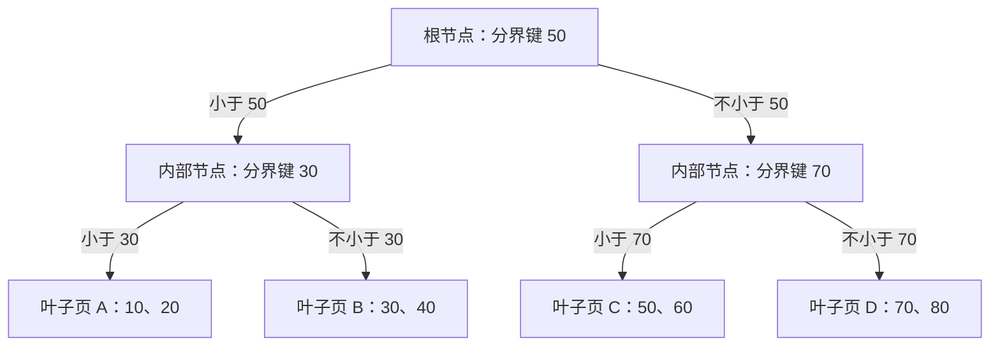
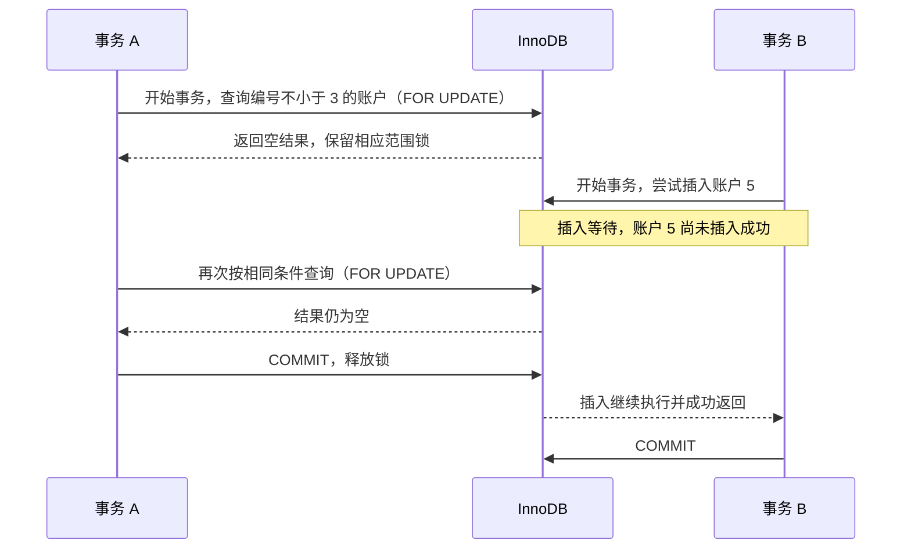

## 索引机制

在[数据库基础](/blog/2024/12/23/database-systems-concepts/)里，我们先确定一行代表什么、表之间怎样联系；[SQL 基础](/blog/2024/07/29/sql-learning-notes/)则让我们能够表达查询需求。数据量变大以后，同一条 SQL 可能需要检查大量记录，返回很少的结果却花很长时间。索引为这类查询提供了更合适的访问路径。这里暂时以 MySQL 为例，讲解索引机制如何设计，如何工作。

### 索引基础

#### 先理解索引用来解决什么问题

假设我们要从大量订单中找出订单 `1001`，或者找出客户 `42` 的所有订单。数据库需要先确定哪些记录符合条件，再读取查询要求的字段。如果没有合适的查找结构，就可能需要逐行检查整张表。

**索引是一种帮助数据库查找记录的数据结构。** 它把用于检索的列值按一定规则组织起来，让数据库能够定位某个值或一段范围。建立索引的列或列组合称为**索引键**；例如，为 `customer_id` 建索引时，数据库会根据客户 ID 的值组织和查找索引记录。

MySQL 的存储引擎负责数据与索引的存放、读取和维护。下面使用 InnoDB 存储引擎，先把 B+ 树的结构与查找过程讲清楚，再看不同类型的索引怎样保存和读取数据。

#### B+ 树怎样组织索引记录

InnoDB 中，这里讨论的常规索引使用 B+ 树结构。B+ 树是一种**平衡的多路查找树**：“多路”表示一个节点可以指向多个子节点；“平衡”表示所有叶子节点位于同一层，查找不同键时不会因为树的一侧特别深而多走很多层。

先认识几个位置：

- **根节点**是整棵树的查找入口。
- **内部节点**是保存导航信息的节点，包含用于判断查找范围的键，以及对应子节点的位置。非叶子的根节点也属于内部节点。
- **叶子节点**位于树的最底层，保存索引记录。这些记录中具体有哪些字段，后面再结合不同类型的索引说明。

在 InnoDB 中，节点对应数据页，默认索引页大小为 16KB。一个页可以保存多条记录或多条导航信息，因此访问一个节点并不等于只检查一个键。[InnoDB 索引页的结构](https://dev.mysql.com/doc/refman/8.4/en/innodb-physical-structure.html)

下面用一棵只画出少量键的 B+ 树说明查找过程。内部节点用分界值表示子页的查找范围，叶子页暂时只展示索引键：



图中省略了叶子页之间的连接。它们按键值顺序连接成 `A ↔ B ↔ C ↔ D`，每个叶子页内的记录也按键值有序组织。内部节点负责找到页，叶子层的连接则让我们能够继续读取相邻的索引记录。

#### B+ 树怎样完成等值与范围查找

先查一个确定的键值 `60`。从根节点开始，`60` 不小于分界值 `50`，进入右侧内部节点；接着，`60` 小于分界值 `70`，进入叶子页 C；最后在该页中找到键值 `60` 对应的索引记录。

这条路径可以写成：

```text
查找 60：根节点 → 右侧内部节点 → 叶子页 C → 对应的索引记录
```

查找时，内部节点中的键用于导航，最终仍需要到叶子节点取得对应记录。即使目标键恰好也出现在内部节点中，它在那里承担的也是划分范围的作用。

再查 `30 ≤ 键值 ≤ 60` 这个范围。先按同样的方式定位起点 `30`，找到叶子页 B；读取该页中的 `30、40` 后，沿叶子页连接进入 C，继续读取 `50、60`，到达范围终点后结束。这些记录位于相邻的叶子页中，可以沿叶子层继续扫描。

这里还有两个层次的定位：B+ 树的目录负责找到哪一个页，页内的结构负责找到哪一条记录。InnoDB 的页目录保存记录组的位置，能够先定位记录组，再在组内查找；不需要把页内每一个键都当成独立的磁盘读取。[从数据页理解页内查找](https://www.xiaolincoding.com/mysql/index/page.html)

#### 为什么选择 B+ 树，以及它的读取成本

我们希望索引能快速找到一个值，也能高效取得一个范围。B+ 树的优势可以结合前面的路径理解：

| 结构特点 | 对查找的影响 |
| --- | --- |
| 一个内部节点包含多个键和子页位置 | 分支较多，同样的数据量通常可以用较少的层级组织。 |
| 内部节点主要保存导航信息，记录集中在叶子层 | 相同大小的内部页可以容纳更多导航信息。 |
| 叶子页按键值顺序连接 | 定位范围起点以后，可以继续扫描相邻的索引记录。 |

内部节点仍保存导航键和子节点位置，只是不保存用于返回查询结果的整行记录。增删也有维护成本：插入可能触发页分裂，删除后可能合并利用率较低的页，相关调整有时会传递到父节点。维护成本取决于写入和页状态，不能仅根据导航键存在冗余，就推断增删一定更便宜。

二叉搜索树的每个节点最多只有两个子节点，数据量变大时通常需要更多层。传统 B 树的内部节点也可以保存数据项；B+ 树把用于取得结果的记录放在叶子层，内部节点更适合集中做导航。Hash 则通过散列函数组织查找，主要适合等值查询，缺少按键值排列的结构，不能直接提供相同的范围扫描和排序能力。这些差异也可以结合[查找与排序算法](/blog/2024/12/18/search-and-sorting-algorithms/)理解。

但“访问了几个节点”和“发生几次磁盘读取”需要分开看。InnoDB 用 **Buffer Pool** 缓存数据页和索引页：页已经在这个内存区域中，就可以直接访问；不在缓存中，才需要读取相关页。因此，较低的树高可以减少定位过程中需要访问的页，但并不是一定会更快。实际查询成本还包括定位之后扫描了多少索引记录，后面讨论二级索引与回表时，会继续沿着这条路径分析。

到这里，我们已经知道索引怎样按键查找、怎样扫描一个范围，以及增删可能带来的结构调整。下面再看 B+ 树与表的数据怎样对应，就能区分聚簇索引、二级索引，以及后面的回表和覆盖索引。

#### 索引的分类分别在描述什么

B+ 树解释了索引键怎样组织和查找。接下来，还要区分索引保存什么内容、承担什么约束，以及由几列组成。同一个索引可以同时符合多种分类：

| 分类角度 | 常见名称 | 名称的含义 |
| --- | --- | --- |
| 按数据结构 | B+ 树、Hash | B+ 树按键值组织有序的树形结构；Hash 通过散列函数组织等值查找。 |
| 按 InnoDB 的数据组织方式 | 聚簇索引、二级索引 | 聚簇索引的叶子记录保存整行数据；二级索引的叶子记录保存索引列值和主键，为其他字段提供查找入口。 |
| 按约束 | 主键索引、唯一索引、普通索引 | 主键要求唯一且非空；唯一索引限制重复键值；普通索引允许键值重复。 |
| 按键的列数 | 单列索引、联合索引 | 单列索引以一列为键；联合索引以多列的组合作为键。 |
| 按索引内容 | 完整列值、字符串前缀、表达式结果 | 可以索引整列的值，也可以只取字符串开头的一部分，或者索引表达式的计算结果。 |

例如，按 `customer_id` 建立的非唯一索引，可以同时是 B+ 树索引、二级索引、普通索引和单列索引。

#### 聚簇索引怎样保存整行数据

**InnoDB 把整行记录按索引键组织在 B+ 树的叶子节点中，这种直接组织数据行的索引叫作聚簇索引。** 内部节点负责导航，叶子节点保存记录本身，所以沿这棵树找到叶子记录，就能取得该行的数据。

如果表声明了主键，InnoDB 就使用主键作为聚簇索引的键。主键规定一行记录的唯一身份，聚簇索引描述数据的存储组织方式；在 InnoDB 中，这两者因此建立了对应关系。

先准备一张独立的订单练习表：

```sql
CREATE TABLE orders_index_demo (
    order_id BIGINT NOT NULL PRIMARY KEY,
    customer_id BIGINT NOT NULL,
    status VARCHAR(16) NOT NULL,
    ordered_at DATETIME NOT NULL,
    total_amount DECIMAL(12, 2) NOT NULL,
    INDEX idx_customer (customer_id)
) ENGINE=InnoDB;
```

`PRIMARY KEY` 声明订单 ID 为主键，`INDEX idx_customer (customer_id)` 声明一个按客户 ID 查找的索引。下面的示例用于说明索引中的内容与查询路径。

假设表中有四笔订单，聚簇索引叶子记录中的用户字段可以简化为：

| order_id | customer_id | status | ordered_at | total_amount |
| --- | --- | --- | --- | --- |
| 1001 | 42 | paid | 2026-10-01 09:00:00 | 100.00 |
| 1002 | 43 | paid | 2026-10-01 08:00:00 | 120.00 |
| 1003 | 42 | pending | 2026-10-01 11:00:00 | 80.00 |
| 1004 | 42 | paid | 2026-10-02 10:00:00 | 90.00 |

这里用 `order_id` 组织记录，所以按订单 ID 查询时，数据库可以根据这个键逐层定位到相应的叶子记录，下面这条查找入口是主键值 `1001`，找到叶子记录后，客户、状态、时间和金额都在该记录中，可以直接读取：

```sql
SELECT * FROM orders_index_demo WHERE order_id = 1001;
```

InnoDB 每张表只有一个聚簇索引，因为整行数据以这一套键顺序组织。有显式主键时使用主键；没有主键时，选择第一个所有键列都非空的唯一索引；如果仍没有合适的索引，再生成隐藏的行 ID 来组织记录。[聚簇索引的选择规则](https://dev.mysql.com/doc/refman/8.4/en/innodb-index-types.html)

#### 二级索引怎样支持其他字段的查询

聚簇索引按订单 ID 组织数据，但我们也经常按客户 ID 查订单。同一客户的订单 ID 可能分散在不同位置，因此需要另一条按客户 ID 查找的路径。

**二级索引是在聚簇索引之外建立的索引。** 对这里的 `idx_customer`，索引键是 `customer_id`，叶子记录保存客户 ID 和对应的主键 `order_id`。上面的四笔订单，在这棵索引中可以简化为：

| customer_id | order_id |
| --- | --- |
| 42 | 1001 |
| 42 | 1003 |
| 42 | 1004 |
| 43 | 1002 |

因此，查客户 `42` 的订单时，可以先在二级索引中找到这个客户对应的范围，再取得该范围内的订单 ID。二级索引为同一批数据提供了另一种查找顺序。

对比两棵树：聚簇索引用订单 ID 导航，叶子记录保存整行；客户二级索引用客户 ID 导航，叶子记录保存客户 ID 和主键。这些主键值用于继续查找聚簇索引中的数据行。

#### 从二级索引理解回表与覆盖索引

如果查询需要客户 `42` 的完整订单数据：

```sql
SELECT * FROM orders_index_demo WHERE customer_id = 42;
```

在使用 `idx_customer` 的情况下，数据库先取得订单 ID `1001`、`1003`、`1004`。但金额、状态和时间没有保存在这个二级索引中，还要拿每个订单 ID 去聚簇索引中查找整行记录。**通过二级索引取得主键，再访问聚簇索引获取所需数据，这一步叫作回表。**

```text
customer_id = 42
    → 客户二级索引
    → 对应的 order_id
    → 按 order_id 查聚簇索引
    → 取得整行记录
```

如果查询只需要订单 ID，情况就不同了：

```sql
SELECT order_id FROM orders_index_demo WHERE customer_id = 42;
```

`customer_id` 用于过滤，`order_id` 用于返回，这两列都在客户二级索引中。**当一个索引能够提供查询所需的列时，这条查询就可以使用覆盖索引，减少读取完整数据行的需要。** 同一个 `idx_customer`，对只返回订单 ID 的查询可以覆盖，对需要金额的查询则不能覆盖。

至此，两种查询成本的区别就比较明确了：找到多少条索引记录，与取得这些记录之后还要不要回表，是两个需要分别观察的问题。后面的索引优化会继续使用这个区别。

#### 联合索引怎样排列多个字段

前面的客户索引只用了一列。当查询同时关心客户、状态和时间时，可以把多个列的组合作为索引键，这就是**联合索引**。

一个 `(customer_id, status, ordered_at)` 联合索引，先按客户排序，同一个客户内再按状态排序，同一个客户和状态内再按时间排序。前面的订单数据按这组键排列，可以简化为：

```text
(42, paid,    2026-10-01 09:00:00)
(42, paid,    2026-10-02 10:00:00)
(42, pending, 2026-10-01 11:00:00)
(43, paid,    2026-10-01 08:00:00)
```

先给定客户 ID，就能找到这个客户对应的连续范围；再给定状态，就能在其中定位更小的一段；这两个值确定以后，该段记录按时间排列。

**最左前缀原则**正是由这种排序方式产生的：从索引最左边的列开始给定条件，才能按通常的方式逐步定位对应范围。只给定 `status` 时，相同状态分散在不同客户的范围里，通常无法直接使用同样的前缀定位方式。

### 什么时候需要索引

#### 先看常用查询怎样访问数据

索引应当围绕查询和约束设计。只看到某一列出现在 `WHERE` 中，还不足以决定是否给它单独建索引。更有用的判断，是数据库能不能借助候选索引减少需要检查的记录、避免额外排序，或者少读取一些完整的数据行。

| 使用场景 | 值得考虑的索引 | 判断时需要同时观察什么 |
| --- | --- | --- |
| 按订单 ID、业务编号查找 | 主键或唯一索引 | 是否真的要求唯一，是否经常按这个键查找？ |
| 查询某个客户的订单 | 以客户 ID 开头的索引 | 每个客户通常有多少订单，查询还筛选什么？ |
| 按客户、状态查询最近的订单 | 匹配过滤和排序的联合索引 | 能否缩小范围，能否按需要的时间顺序读取？ |
| 表连接 | 被查找一侧连接字段上的索引 | 连接顺序、字段类型是否匹配，每次连接会命中多少行？ |
| 分组、排序、最小值或最大值查询 | 与实际访问顺序匹配的索引 | 查询形态是否满足索引优化条件，是否仍需额外处理？ |
| 只返回少量字段的高频查询 | 能覆盖这些字段的索引 | 减少读取整行的收益，是否足以抵消新增索引的成本？ |

例如，“某个客户最近的已支付订单”同时涉及客户、状态、时间顺序和返回数量。单独给这几个字段各建一个索引，通常不能提供一个联合索引所维护的组合顺序。候选索引需要针对完整 SQL 来评估。

唯一索引还有另一类价值：阻止违反业务规则的重复写入。即使某个唯一键并不经常被查询，只要数据库需要维护这项约束，它仍然有存在的理由。这和纯粹为了加速查询建立的普通索引，要分别判断。

#### 区分度需要结合数据分布理解

字段的区分度通常用不同值的数量与总记录数的比值来描述。客户 ID 往往比订单状态具有更多不同值，但真正影响一次查询成本的，是这条条件预计命中多少记录。

假设大部分订单已经完成，待处理订单只有很少一部分，后台又经常查待处理订单。即使 `status` 只有几个可能值，针对待处理状态的查询仍可能从索引中获益。反过来，一个有很多不同值的时间字段，如果查询覆盖绝大多数历史记录，也未必适合逐条通过二级索引回表。所以“低区分度字段不要建索引”“匹配超过某个固定比例就不走索引”都不适合作为通用规则。还要考虑返回字段、排序、`LIMIT`、缓存状态及优化器估算的成本。

#### 把读取收益与维护成本放在一起

索引需要占用磁盘空间，也会占用缓存。插入和删除记录时，需要维护相应索引；更新索引列时，也可能改变索引记录的位置。

小表、需要处理大部分记录的报表查询、很少使用的过滤条件，以及已有索引能够满足的查询，新增普通索引的收益可能有限。频繁变化的字段也要比较读写成本：订单状态虽然会更新，但后台查询可能非常依赖它，仍然可能值得索引。决定保留多少索引，应看实际查询负载，而不是给每列都准备一个。

### 索引应该如何优化

#### 按查询组织联合索引

继续看这个订单列表查询：

```sql
SELECT order_id, ordered_at, total_amount
FROM orders_index_demo
WHERE customer_id = 42
  AND status = 'paid'
  AND ordered_at >= '2026-10-01 00:00:00'
ORDER BY ordered_at DESC
LIMIT 20;
```

可以评估下面这个候选索引：

```sql
CREATE INDEX idx_customer_status_time
ON orders_index_demo (customer_id, status, ordered_at);
```

客户和状态是等值条件，它们确定一段记录；在这段记录内部，时间有序，可以继续限制时间范围，并从较新的记录向较旧的记录读取。与只按客户定位后再筛状态、再排序相比，这个索引提供了更贴合查询的路径。“等值条件在前，范围或排序字段随后”是这类查询的一个设计起点，还要结合其他 SQL 判断顺序。

#### 分清减少扫描与减少回表

上面的列表还需要 `total_amount`，它不在候选二级索引中，匹配记录仍需要回表。如果列表只返回订单 ID 和时间，可以改成：

```sql
SELECT order_id, ordered_at
FROM orders_index_demo
WHERE customer_id = 42
  AND status = 'paid'
  AND ordered_at >= '2026-10-01 00:00:00'
ORDER BY ordered_at DESC
LIMIT 20;
```

这里的候选联合索引能够覆盖这条查询：客户、状态和时间列可用于过滤，时间列和主键可用于返回，所需字段都能由索引提供。二级索引已经保存主键，因此仅为返回 `order_id`，不必再把它重复加入索引定义。覆盖可以减少读取完整记录的需要，不过在某些事务可见性检查场景中，InnoDB 仍需要访问聚簇索引。

另一个优化是**索引条件下推（Index Condition Pushdown，ICP）**。假设候选索引换成 `(customer_id, ordered_at, status)`，下面讨论的是这一排列下的查询路径：

```sql
SELECT order_id, total_amount
FROM orders_index_demo
WHERE customer_id = 42
  AND ordered_at > '2026-10-01 00:00:00'
  AND status = 'paid';
```

在这组键的顺序下，客户等值条件和时间范围可以用于定位扫描区间；后面的状态通常不能继续把这个时间区间缩成一个更小的连续区间。但状态仍在索引记录里，如果查询满足 ICP 的适用条件，存储引擎可以先检查状态，再为通过检查的记录读取整行，从而减少回表。覆盖索引解决的是所需字段能否直接由索引提供；ICP 解决的是需要读取整行时，能否先在索引中排除一些记录。它们都可能减少读取成本，却不一定减少需要遍历的索引记录数。

#### 用 EXPLAIN 检查实际访问路径

前面的索引只是候选方案，优化器最终采用什么路径，需要看**执行计划**：数据库准备用哪个索引、预计检查多少记录，以及是否需要额外排序。可以在订单查询前加上 `EXPLAIN`，这里指定传统表格格式：

```sql
EXPLAIN FORMAT=TRADITIONAL
SELECT order_id, ordered_at, total_amount
FROM orders_index_demo
WHERE customer_id = 42
  AND status = 'paid'
  AND ordered_at >= '2026-10-01 00:00:00'
ORDER BY ordered_at DESC
LIMIT 20;
```

先观察三个字段即可：

| 字段 | 主要看什么 |
| --- | --- |
| `key` | 优化器实际选择的索引，是否与候选方案一致。 |
| `rows` | 预计需要检查的记录数，是否仍要经过很大的范围。 |
| `Extra` | 查询还使用了哪些处理方式，例如覆盖索引、索引条件下推或额外排序。 |

`Extra` 中的 `Using index` 表示索引覆盖了所需列，`Using index condition` 表示使用 ICP，`Using filesort` 表示需要额外排序，它们分别对应前面讨论的不同成本。

`rows` 是估算值，不能当作实际扫描行数或查询耗时。练习表数据很少时，优化器也可能选择全表扫描；评估索引效果应使用接近实际规模和分布的数据，而不是只看索引是否存在。[EXPLAIN 的字段说明](https://dev.mysql.com/doc/refman/8.4/en/explain-output.html)

### 分页应该如何设计

分页查询需要同时考虑列表的使用方式和数据库的访问路径。每页只返回 20 条，并不意味着数据库只处理了 20 条。页面是否允许任意跳转、是否显示精确总数，也会影响后端应该怎样查询。

#### 先确定排序与接口约定

继续使用订单练习表，列表按下单时间从新到旧排列。如果只写 `ORDER BY ordered_at DESC`，时间相同的订单之间没有确定的顺序，换一个执行计划就可能改变它们的先后。可以补上唯一的订单 ID，写成 `ORDER BY ordered_at DESC, order_id DESC`，让每笔订单都有明确的位置。前面的 `(customer_id, status, ordered_at)` 索引可以继续作为候选。在 InnoDB 中，二级索引还携带主键 `order_id`，优化器能够利用这个索引扩展处理查找与排序；客户和状态固定后，可以按时间、订单 ID 的顺序读取。

接口层也要确定翻页约定。需要输入页码直接跳到某一页的后台列表，可以使用页码和页大小；连续向下浏览的订单流，可以使用上一页留下的游标。服务端应限制页大小，并与前端约定返回哪些字段、是否提供总数。若页面只需要“还有下一页”，通常不必每次都计算精确总数。

#### OFFSET 分页为什么越往后越贵

传统页码分页使用 `LIMIT offset, page_size`。页码从 1 开始时，`offset = (page_no - 1) × page_size`。假设客户 `42` 已有足够多的已支付订单，下面取跳过 50000 条后的 20 条：

```sql
SELECT order_id, ordered_at, total_amount
FROM orders_index_demo
WHERE customer_id = 42
  AND status = 'paid'
ORDER BY ordered_at DESC, order_id DESC
LIMIT 50000, 20;
```

**OFFSET 表示跳过多少条匹配结果，不是一个可以直接定位的索引键。** B+ 树能按键值找到起点，却不能直接把“第 50001 条匹配结果”转换成一个键。在常见的有序扫描路径下，这条查询要经过约 50020 条匹配记录，再丢弃前 50000 条。差距主要体现在这些被跳过的记录上：需要遍历更多索引项、访问更多页；当返回字段不在二级索引中时，还可能为最后不会返回的记录读取整行。即使页已经在缓存中，扫描与处理也需要 CPU 时间。

#### 用覆盖索引延后读取整行

必须保留任意页码跳转时，可以先通过索引取出这一页的主键，再读取需要展示的字段。这种做法通常称为**延迟关联**，也可以理解为延后回表：

```sql
SELECT o.order_id, o.ordered_at, o.total_amount
FROM orders_index_demo AS o
JOIN (
    SELECT order_id, ordered_at
    FROM orders_index_demo
    WHERE customer_id = 42
      AND status = 'paid'
    ORDER BY ordered_at DESC, order_id DESC
    LIMIT 50000, 20
) AS page_ids ON page_ids.order_id = o.order_id
ORDER BY o.ordered_at DESC, o.order_id DESC;
```

内层所需的客户、状态、时间和主键，都能由候选索引提供，可以先扫描较窄的索引记录；外层再按这一页的主键读取金额等字段。内层的 `LIMIT` 使它不能直接与外层合并为同一个查询块，外层也必须显式声明排序，不能依赖内层结果的返回顺序。

这里主要减少的是读取完整记录的成本。内层仍然要跨过前面的 50000 条匹配结果，因此偏移量很大时，扫描成本依然存在。若原查询已经由索引覆盖，或者偏移量很小，增加一次关联未必更划算。

#### 用游标从上一页末尾继续查询

连续翻页可以改用**游标分页（Keyset Pagination）**：保存上一页最后一条记录的排序键，下一页从这个键之后继续查找。这里的游标是应用保存的分页位置。

假设上一页最后一条订单的时间是 `2026-10-02 10:00:00`，订单 ID 是 `1004`。按时间、订单 ID 都降序的规则，下一页需要时间更早的订单，或者时间相同、ID 更小的订单：

```sql
SELECT order_id, ordered_at, total_amount
FROM orders_index_demo
WHERE customer_id = 42
  AND status = 'paid'
  AND (
      ordered_at < '2026-10-02 10:00:00'
      OR (ordered_at = '2026-10-02 10:00:00' AND order_id < 1004)
  )
ORDER BY ordered_at DESC, order_id DESC
LIMIT 21;
```

时间与 ID 共同构成翻页边界。只记住时间，会漏掉同一时间下尚未返回的订单；只写 `order_id < 1004`，又不能表达这个按时间优先排列的列表。使用严格的小于条件，才能排除上一页已经返回的末尾记录。这样的复合边界需要与索引顺序一起检查，确认优化器确实形成了合适的范围访问。

每页展示 20 条时，可以多取一条：取得 21 条，就返回前 20 条，并设置 `has_more = true`；不足 21 条，就没有更多记录。有下一页时，`next_cursor` 应取**实际返回的最后一条，也就是第 20 条记录**的时间与 ID，不能取那条只用于探测的第 21 条，否则会跳过它。第一页省略游标边界，后续请求携带游标和相同的筛选条件；筛选或排序改变后，应重新开始分页。在合适的索引和执行计划下，游标条件让数据库从边界附近继续扫描，不必反复遍历之前的所有页。


如果每页都在独立事务中查询，游标不会自动把整个列表固定在同一份快照中。例如，上一页已经返回订单 `1004`，游标保存它的时间 `2026-10-02 10:00:00`；如果这笔订单的下单时间随后被改成同一天的 `09:00:00`，下一页仍使用旧游标，它就可能再次落入查询范围，造成重复。未返回的订单若被移到游标之前，也可能在后续翻页中被遗漏。

因此，排序字段应尽量保持稳定，接口也要约定列表是随数据实时变化，还是要求读取固定的一组结果。游标减少的是从头跳过记录的成本，不会自动提供跨多次请求的一致快照。

| 分页方式 | 主要读取成本 | 更适合的需求 |
| --- | --- | --- |
| OFFSET 分页 | 偏移量越大，需要经过的记录通常越多。 | 浅页查询、任意页码跳转。 |
| 延迟关联 | 仍扫描偏移量对应的索引记录，主要减少提前读取整行。 | 需要跳页，且完整记录读取成本较高。 |
| 游标分页 | 用排序键定位边界，再继续读取本页，额外过滤仍可能扩大扫描。 | 连续翻页、批量遍历。 |

## 事务

索引帮助数据库找到记录，事务则要解决另一组问题：几次修改怎样一起完成，多个事务同时读写时，又分别能看到哪些数据。下面以 InnoDB 为例，从转账开始，再逐步理解隔离级别、历史版本与幻读。

### 从转账理解事务与 ACID

#### 为什么要把两次修改放在一起

假设 `accounts_tx_demo` 是一张账户表，`account_id` 是主键，`balance` 保存余额。账户 1 有 1000 元，账户 2 有 500 元，现在要从账户 1 向账户 2 转账 100 元。

数据库需要先让账户 1 减少 100，再让账户 2 增加 100。如果两次修改分别提交，第一步完成后程序中断，就可能留下“已经扣款，但没有入账”的结果。我们希望把它们作为一个整体：全部确认成功后提交；决定放弃时，撤销这组尚未提交的修改。

**事务（Transaction）就是这样一个共同提交或回滚的工作单元。** 账户存在、余额充足且两次更新都成功时，转账的基本形式可以写成：

```sql
START TRANSACTION;

UPDATE accounts_tx_demo
SET balance = balance - 100.00
WHERE account_id = 1;

UPDATE accounts_tx_demo
SET balance = balance + 100.00
WHERE account_id = 2;

COMMIT;
```

`START TRANSACTION` 开始事务，`COMMIT` 提交其中的修改，成功后的余额为 900 和 600。若在提交前决定放弃，可以执行 `ROLLBACK`，撤销本轮尚未提交的修改。下面的并发案例彼此独立，讨论余额时都重新从 1000 开始。

#### ACID 分别描述什么

事务的四项性质简称为 **ACID**，继续用转账来理解：

| 性质 | 含义 | 对应转账中的要求 |
| --- | --- | --- |
| 原子性 Atomicity | 事务中的修改作为整体提交或回滚。 | 扣款、入账共同完成，放弃时一起撤销。 |
| 一致性 Consistency | 操作前后符合数据约束与业务规则。 | 无手续费时，总余额仍为 1500，两边变动金额相同。 |
| 隔离性 Isolation | 规定并发事务之间的可见性与相互影响。 | 其他请求同时查询或修改余额时，遵循确定的读取和冲突处理规则。 |
| 持久性 Durability | 已成功提交的结果在故障恢复后能够保留。 | 数据库重启后，已经确认的转账结果仍然存在。 |

一致性需要正确的业务逻辑。例如，把“扣 100、加 80”放进事务并提交，仍会得到错误的转账结果，事务不能替程序判断金额是否合理。隔离性要处理的是多个事务交错读写时的相互影响。持久性强调故障恢复后能够保留已提交的结果。实现时可以先可靠持久化必要的日志，即使相关数据页尚未全部写回数据文件，也能通过日志恢复；下一节再介绍这两者的关系。

### undo log 与 redo log 怎样支撑事务

#### undo log：撤销修改与重建旧版本

**undo log（回滚日志）** 保存撤销修改所需的信息。例如，把余额从 1000 改成 800 时，需要保留恢复旧值所需的内容；事务回滚时，InnoDB 可以据此撤销修改。

它还有一个与隔离有关的用途：其他事务可能需要读取修改前的余额，InnoDB 可以通过 undo 信息重建历史版本。因此，undo 不仅服务于回滚，也为后面介绍的多版本读取提供基础。

#### redo log：记录修改以便故障恢复

前面提到，数据页会缓存在 Buffer Pool 中。修改先发生在内存页里，数据文件可能尚未写入最新内容；如果此时断电，仅保存在内存中的修改就可能丢失。

**redo log（重做日志）**记录数据页的修改信息。将必要的日志可靠持久化后，数据库可以在重启时重放这些修改，恢复尚未完整写入数据文件的内容。数据页随后逐步写回，不必每次提交都把涉及的页全部刷完，这种**先持久化日志、再写回数据页**的做法叫作 **WAL（Write-Ahead Logging，预写式日志）**。

两种日志分工不同：undo 支持撤销与历史版本，redo 支持恢复数据修改。

### 并发读取的问题与四种隔离级别

#### 脏读、不可重复读与幻读

一个事务正在修改数据时，另一个事务可能也在读取。先区分三种现象：

| 现象 | 关注的问题 | 例子 |
| --- | --- | --- |
| 脏读 Dirty Read | 读到了其他事务尚未提交的修改。 | B 将余额改成 800，尚未提交，A 已经读到 800；B 随后回滚。 |
| 不可重复读 Non-repeatable Read | 同一事务重复读取同一记录，值因其他事务的提交而改变。 | A 先读到 1000；B 改成 800 并提交；A 再读到 800。 |
| 幻读 Phantom Read | 同一事务重复按相同条件查询，匹配的记录集合发生变化。 | A 查询 `account_id >= 3` 时为空；B 插入账户 5 并提交；A 再查出现账户 5。 |

脏读关注修改有没有提交，不可重复读关注同一条记录的值，幻读关注哪些记录满足条件。幻读常表现为条数变化，但要理解的是匹配记录集合的变化，而不只是一个数量。

#### 四种隔离级别限制了什么

InnoDB 支持四种隔离级别，默认是**可重复读**。这里先把**快照**理解为读取所依据的一份可见数据状态，后面再解释它怎样选择历史版本。

| 隔离级别 | 主要读取规则 |
| --- | --- |
| 读未提交 READ UNCOMMITTED | 普通查询可能读到其他事务尚未提交的修改，因此允许脏读。 |
| 读已提交 READ COMMITTED，简称 RC | 每条普通查询使用新的读取快照，读取已提交版本；前后查询可能得到不同值或记录集合。 |
| 可重复读 REPEATABLE READ，简称 RR | 同一事务的普通查询复用首次此类查询建立的快照，其他事务后续的提交不会刷新这份快照；自身写入另有可见性规则。 |
| 串行化 SERIALIZABLE | 施加更强的并发约束，使执行结果符合某种先后次序；显式事务中的普通读取也会加锁，冲突操作可能等待。 |

按 SQL 标准的异常划分，RC 避免脏读，RR 进一步避免不可重复读，SERIALIZABLE 还约束幻读。标准中的 RR 允许幻读，但 InnoDB 的 RR 对普通查询和锁定查询分别有处理办法，最后一节再具体讨论。

隔离规则越强，通常需要更多并发约束，但不能把串行化理解成整个数据库只许一个事务运行。接下来先看 RC 和 RR 怎样通过多版本读取，使普通查询可以在其他事务修改记录时继续获得合适的内容。

### MVCC 怎样通过版本链与 Read View 选择数据

#### 版本链保存了什么

**MVCC（Multi-Version Concurrency Control，多版本并发控制）** 通过记录的不同版本和可见性规则处理并发读取。在 RC、RR 下，普通查询能够读取需要的历史内容，而不必仅因为另一个事务正在更新，就等待它结束。

聚簇索引的叶子记录保存整行数据，其中还有两项与事务有关的隐藏信息：

- **`DB_TRX_ID`**：标识最后插入或修改这条记录的事务。
- **`DB_ROLL_PTR`**：指向 undo 记录的回滚指针，可以据此重建修改前的版本。

例如，余额由不同事务先后从 1000 改成 800，再改成 750。当前记录与重建出的历史版本，可以用下面的逻辑链条表示：


图中画的是版本之间的关系，undo 并不一定保存一份完整行副本，而是保存重建旧内容所需的信息。

#### Read View 怎样判断可见性

**Read View（读视图）** 保存建立视图时的事务状态，用来判断哪些写入版本对这次读取可见。它不是把整张表复制一份。

下面用四个名字表示视图中的事务信息和可见性边界：

| 信息 | 含义 |
| --- | --- |
| `creator_trx_id` | 视图所属事务的 ID，用于识别自身修改。 |
| `m_ids` | 建立视图时，其他仍活跃、尚未提交的读写事务 ID 集合。 |
| `min_trx_id` | 活跃集合的最小 ID；集合为空时可与下面的上界相同。 |
| `max_trx_id` | 建立视图时，下一个待分配的事务 ID，并非活跃集合的最大值。 |

检查某个版本的写事务 ID 时，按下面的规则判断：

1. **当前事务自己的修改**：对自身可见。
2. **小于 `min_trx_id`**：对应修改在视图建立前已提交，可见。
3. **大于或等于 `max_trx_id`**：这个 ID 在建立视图后才分配，对此视图不可见。
4. **位于两条边界之间**：在 `m_ids` 中，表示建立视图时尚未提交，不可见；不在集合中，表示当时已提交，可见。

#### 用具体版本走一遍判断过程

假设视图所属事务已经取得 ID `100`，其他活跃写事务为 `103`、`106`，下一个待分配 ID 为 `108`：

```text
creator_trx_id = 100
m_ids          = [103, 106]
min_trx_id     = 103
max_trx_id     = 108
```

读取前面的余额版本链时：

| 版本的写事务 ID | 余额 | 判断结果 |
| --- | --- | --- |
| 108 | 750 | 达到视图上界，不可见。 |
| 103 | 800 | 在建立视图时的活跃集合中，不可见。 |
| 90 | 1000 | 小于视图下界，可见。 |

因此，这份视图读到 1000。即使事务 `103` 稍后提交，只要仍使用这份 Read View，它也仍然属于“建立视图时尚未提交”的事务，视图不会跟着别人的提交自动变化。

边界之间也不全是不可见版本。例如，ID `104` 不在这个活跃集合中，由它写出的版本就可以被该视图读取。判断依据是**建立视图时的事务状态**，不是只看 ID 大小。

### RC 与 RR 为什么会读到不同结果

#### 区别在于 Read View 的创建时机

RC 和 RR 都可以沿版本链读取历史数据。这里的**普通一致性查询**是指它们按照可见性快照读取的普通 `SELECT`，通常也称为**快照读**。两种级别的主要区别是是否复用同一份 Read View：

- **RC**：每条普通一致性查询建立新的 Read View。
- **RR**：**同一事务**的普通一致性查询复用首次此类查询建立的 Read View。

`START TRANSACTION` 已经开始 SQL 事务，但 RR 的 Read View 通常要到首次普通一致性查询时才建立。如果其他事务在这次查询之前提交，第一次查询就可以看到它的结果。

#### 从提交前后看两种读取结果

重新让账户 1 从余额 1000 开始。A、B 表示两个事务，A 分别在 RC、RR 下各做一轮，查询都是普通 `SELECT`：

| 顺序 | 事务 A | 事务 B |
| --- | --- | --- |
| 1 | 开始事务，第一次查询余额，读到 1000。 | — |
| 2 | — | 开始事务，将余额改成 800，暂不提交。 |
| 3 | 再次查询：RC、RR 都读到 1000。 | 修改尚未提交。 |
| 4 | — | 提交事务。 |
| 5 | 再次查询：RC 读到 800，RR 仍读到 1000。 | — |
| 6 | 提交事务；新的事务再查询，可以读到 800。 | — |

第三步，B 尚未提交，RC 和 RR 都不能读取它的新版本，需要找到可见的旧内容。第五步，RC 建立新视图，B 已经提交，800 变得可见；RR 复用旧视图，仍把 B 的修改视为“建立视图时尚未提交”，所以继续读到 1000。

这就把隔离级别与前面的实现连起来了：**版本链提供可读取的历史内容，Read View 判断可见性，视图的创建时机决定是否保持同一份读取依据。**

### 快照读、当前读与幻读的边界

这一节先分开两个问题：**A 能看到哪些记录，B 能不能插入新的记录。** 前者涉及读取版本，后者涉及是否已经锁住相应范围。下面都按 InnoDB 的可重复读（RR）讨论，A、B 表示两个事务，各个示例分别从所说明的初始数据开始。

#### 先用同一个账户区分快照读与当前读

先看账户 1，初始余额为 1000。A 开始事务，第一次普通查询读到 1000，建立了 Read View；随后 B 把余额改成 800 并提交。此时 A 的事务仍未结束。

A 可以使用两种查询方式：普通 `SELECT` 按已有 Read View 选择版本，叫作**快照读**；加上 `FOR UPDATE` 的查询读取当前可用的记录并取得相应锁，属于**当前读**。继续在 A 中执行：

```sql
-- 快照读
SELECT balance
FROM accounts_tx_demo
WHERE account_id = 1;

-- 当前读
SELECT balance
FROM accounts_tx_demo
WHERE account_id = 1
FOR UPDATE;
```

| A 的查询 | 读到的余额 | 为什么 |
| --- | --- | --- |
| 普通 `SELECT` | 1000 | 旧 Read View 不包含 B 后来提交的修改，沿版本链读取旧值。 |
| `SELECT ... FOR UPDATE` | 800 | 按当前读取规则取得 B 已提交的记录，并锁住它。 |
| 再次普通 `SELECT`，A 尚未修改该行 | 1000 | 锁定读不会刷新原来的 Read View。 |

两种查询只是读取依据不同。快照读关注这份视图允许读哪个版本；当前读关注现在可用的记录，并保护后续依赖它的操作。如果其他事务还在修改该记录，当前读可能需要先等待那个事务结束。

#### 快照读看不到新行，但不会阻止别人插入

余额变化是同一条记录的值变化。**幻读关注的是结果里多出了此前没有的匹配记录**：同一事务前后按相同条件查询，另一个事务插入并提交了符合条件的新行，后一次查询把它读出来了。 现在重新开始一轮，表中只有账户 1、2，A 想查询编号不小于 3 的账户：

```sql
SELECT account_id
FROM accounts_tx_demo
WHERE account_id >= 3;
```

按下面的顺序执行：

| 顺序 | 事务 A | 事务 B |
| --- | --- | --- |
| 1 | 开始事务，执行普通查询，结果为空，建立 Read View。 | — |
| 2 | — | 插入账户 5，并提交成功。 |
| 3 | 再做相同的普通查询，结果仍为空。 | — |
| 4 | 把查询改为 `SELECT ... FOR UPDATE`，可以看到账户 5。 | — |

第三步时，**账户 5 已经存在，只是 A 的旧快照看不到它**。普通查询并没有禁止 B 插入；它通过保持读取依据，避免 B 的新增记录改变本轮快照读的结果。

第四步切换成了当前读，账户 5 已经提交，因此可以被读取。这里切换了查询方式，不是相同读取方式突然丢掉了可重复读的保证。更关键的是，**锁在 B 插入之后才取得，不能阻止一件已经完成的插入**。

#### 要阻止并发插入，需要提前锁住查询范围

如果 A 的要求是“检查完这个范围以后，到操作结束前，不允许别人在其中插入新账户”，就要改变上一轮的执行顺序。

重新恢复到只有账户 1、2 的状态，A 一开始就在事务内做范围锁定查询：

```sql
START TRANSACTION;

SELECT account_id, balance
FROM accounts_tx_demo
WHERE account_id >= 3
FOR UPDATE;

-- A 保持事务未结束，下面再让 B 尝试插入
```

此时查询虽然为空，相关插入区间仍会受到保护。B 再尝试插入账户 5，过程是：



这次 A 前后两次当前读都为空，是因为 **B 的插入还没有完成**。A 结束事务、释放锁后，B 才能继续插入并提交；新的事务随后就可以看到账户 5。

为什么没有查到记录也能加锁？因为需要保护的不只是已有记录，还有索引中可供新记录插入的位置。**间隙锁**限制这些位置上的插入，**记录锁**保护已有索引记录，**next-key lock（临键锁）** 结合记录与其前面的间隙来保护范围。

对照前一轮：快照读允许 B 插入，但 A 继续看旧快照；提前取得范围锁，则让 B 的插入等待。两种办法都能让本轮读取结果保持稳定，做到这一点的方式却不同。

#### 自己修改后为什么又能看见这条记录

重新从只有账户 1、2 的状态开始。A 开始 RR 事务，第一次普通查询 `account_id >= 3`，结果为空，并建立 Read View。随后 B 插入账户 5，余额为 1000，并提交；A 尚未结束事务，再做相同的普通查询，仍然看不到账户 5。

现在 A 没有结束事务，而是执行：

```sql
UPDATE accounts_tx_demo
SET balance = 900.00
WHERE account_id = 5;

SELECT account_id, balance
FROM accounts_tx_demo
WHERE account_id >= 3;
```

更新可以找到当前已经存在的账户 5；更新后的普通查询，也能返回账户 5，余额为 900。看起来是“原先看不到的记录出现了”，但这里要按两个动作分别理解：

1. **`UPDATE` 处理当前记录**，所以能够修改旧快照看不到、但已经由 B 提交的账户 5。
2. **自己的修改对自己可见**，所以后面的普通查询能够读取 A 自己改出的版本。

原来的 Read View 没有刷新，其他事务后来的提交也不会全部进入旧快照；只是自己的修改对自己可见。理解 InnoDB 的 RR 时，要区分三个前提：普通快照读复用既有视图；提前锁住范围的当前读限制该范围内的并发插入；切换读取方式或读取自身修改时，结果可能与先前的快照读不同。

## 锁管理

前面用 MVCC 解释了事务能看到哪些版本，也提到范围锁能够让插入等待。这里继续看锁本身：多个事务同时访问数据时，哪些操作可以一起进行，哪些操作必须等别人完成。

本章行级锁以 InnoDB 的可重复读（RR）为例；A、B 是不同会话中的事务，各个例子独立。

### 锁怎样协调并发访问

A 修改账户 1 后尚未提交，B 也要修改同一条记录。InnoDB 会用锁协调这两次修改：B 先等待，A 提交或回滚、释放锁后，B 再继续处理。

**锁用来限制冲突操作能否同时进行。** 对同一条索引记录，先区分两种加锁方式：

| A 已持有的锁 | B 申请共享锁 S | B 申请独占锁 X |
| --- | --- | --- |
| 共享锁 S（Shared） | 可以同时持有。 | 需要等待。 |
| 独占锁 X（Exclusive，也称排他锁） | 需要等待。 | 需要等待。 |

共享锁允许多个事务以加锁方式读取同一记录，独占锁保护修改。这里的“读写互斥”指需要相应锁的操作，**普通快照读仍可读取符合 Read View 的历史版本**。

查询时，`SELECT ... FOR SHARE` 申请共享锁，`SELECT ... FOR UPDATE` 申请独占锁，`UPDATE`、`DELETE` 会自动为处理的数据取得独占锁。

例如，继续使用前面的账户表，A 执行到锁定查询后，先保持事务未结束：

```sql
START TRANSACTION;

SELECT balance
FROM accounts_tx_demo
WHERE account_id = 1
FOR UPDATE;

-- 此时让 B 在另一个会话中尝试更新账户 1
-- A 完成操作后，再执行 COMMIT 或 ROLLBACK
```

B 的更新可能停在等锁这一步。**在这个显式事务中，查询执行完并不等于锁已经释放**；锁定读取得的锁会保留到事务提交或回滚。

按**作用范围**，锁又分为全局锁、表级锁和行级锁。S、X 描述兼容关系，后面这组名称描述作用范围，它们是不同的分类维度。

### 全局锁与四类表级锁

#### 全局锁：让整个实例暂时停止写入

全局读锁可以通过 `FLUSH TABLES WITH READ LOCK` 取得，释放时使用 `UNLOCK TABLES`，持有锁的会话断开也会释放。它作用于整个 MySQL 实例，而不只是当前选择的某个数据库：普通查询仍可进行，数据修改和表结构变更会受到阻塞。

全库逻辑备份需要让各张表的数据对应同一份状态。假设账户表中，用户余额为 1000 元；库存表中，商品还有 10 件，每件 100 元。购买一件商品的事务会同时扣除 100 元、减少一件库存，提交后余额为 900 元，库存为 9 件。

如果备份没有使用一致性快照，也没有暂停写入，就可能出现下面的顺序：

| 顺序 | 发生的操作 | 本步结果 |
| --- | --- | --- |
| 1 | 先备份账户表，此时购买尚未发生。 | 用户余额为 1000 元。 |
| 2 | 购买事务完成扣款、扣库存并提交。 | 数据库中的余额变为 900 元，库存变为 9 件。 |
| 3 | 再备份库存表。 | 商品库存为 9 件。 |

这份备份恢复后，会出现余额仍为 1000 元、库存却只剩 9 件的结果：商品已经减少，购买对应的扣款却不在备份里。购买事务本身一起提交了两次修改，问题出在备份先后读取了提交前、提交后的数据。

在备份期间持有全局读锁，可以阻止这些修改，让账户表和库存表保持在同一数据状态。代价是购买等业务的写入也需要等待备份释放锁。

#### 表锁：限制整张表的访问

显式表锁通过 `LOCK TABLES` 取得，常见形式是：

| 形式 | 持锁会话 | 其他会话 |
| --- | --- | --- |
| `LOCK TABLES accounts_tx_demo READ` | 可以读这张表，不能写。 | 可以读，写入需要等待。 |
| `LOCK TABLES accounts_tx_demo WRITE` | 可以读写这张表。 | 对这张表的读写需要等待。 |

持锁会话也不能随意访问未声明锁定的其他表。可以用 `UNLOCK TABLES` 显式释放这类表锁，会话断开时也会释放。`LOCK TABLES` 在尝试加锁前会隐式提交当前事务，因此不能把它当成普通行锁语句直接嵌入前面的转账事务。

表锁可能阻塞与目标记录无关的请求，InnoDB 的普通事务读写主要使用更细的行级锁。[显式表锁的行为](https://dev.mysql.com/doc/refman/8.4/en/lock-tables.html)

#### 元数据锁：保护表结构

**元数据锁（Metadata Lock，MDL）** 保护字段、索引等结构定义，避免一个查询还在读取，另一个会话却删掉了相关字段。访问表时会自动取得相应 MDL，普通数据读写通常兼容，与之冲突的结构变更需要等待。

例如，A 在显式事务中查询账户表后迟迟不结束事务，B 执行 `ALTER TABLE` 就可能等待。**查询已经返回，MDL 通常仍保留到事务结束**；结构变更排队后，后续查询也可能跟着等待。因此，前面说“普通 `SELECT` 不加行锁”，指的是它不锁住数据记录，**并不表示数据库完全没有为这次查询加锁**。

#### 意向锁：说明表内存在怎样的行锁需求

申请整表锁时，需要知道表里是否有其他事务锁定记录，逐条检查的成本很高。

InnoDB 会在取得行锁前自动取得表级意向锁：**意向共享锁 IS** 表示共享行锁需求，**意向独占锁 IX** 表示独占行锁需求。比如 A 用 `FOR UPDATE` 锁定账户 1，会先取得表级 IX，申请整表锁的 B 可以据此判断冲突。

**意向锁本身不会把整张表的数据都锁住。** A、B 都可以持有 IX，再分别修改不同的账户；是否等待，还要看它们申请的具体行锁是否冲突。

#### AUTO-INC 锁：协调自增编号的分配

字段声明为 `AUTO_INCREMENT` 后，并发插入需要协调自增值的分配。**AUTO-INC 锁**是服务于这一过程的特殊表级锁，它通常持有到当前插入语句结束，**不必等到整个事务提交**。

InnoDB 也提供更轻量的分配方式，由 `innodb_autoinc_lock_mode` 控制：

| 模式 | 基本处理方式 |
| --- | --- |
| 0，传统模式 | 插入使用表级 AUTO-INC 锁，持有到语句结束。 |
| 1，连续模式 | 能预先确定行数的普通插入通常只在分配编号时短暂协调；`INSERT ... SELECT` 等批量插入仍使用表级 AUTO-INC 锁。 |
| 2，交错模式 | 不使用表级 AUTO-INC 锁，允许多个插入语句交错分配编号。 |

这些模式在编号分配的可预测性和插入并发之间取舍。例如，在模式 2 下，自增编号从 1 开始分配，A 用 `INSERT ... SELECT` 批量插入两条记录，B 同时插入一条记录。可能出现这样的顺序：A 的第一条记录取得 1，B 取得 2，A 的下一条记录取得 3。

如果备库只重放两条 SQL，并先完整执行 A，再执行 B，A 的两条记录就可能获得 1、2，B 再取得后续编号，与原先的分配结果不同。这就是基于语句的复制不适合交错模式的原因。按行复制传递实际行内容，其中包含已经分配好的编号，因此不需要重现同样的分配时序。

### 行级锁怎样保护记录与间隙

InnoDB 的行级锁作用于**索引记录及其间隙**。没有显式主键时，也会选择或生成聚簇索引来加锁，不能只按最终返回几行理解锁的范围。

下面重新准备独立数据：账户编号为 `1、3、7`，`account_id` 是主键。

#### 记录锁：保护已有的索引记录

**记录锁（Record Lock）** 只锁定某条索引记录。比如，账户 7 上的 X 型记录锁会让其他事务对它的更新、删除或锁定读取等待；但这个记录锁本身，不会禁止插入账户 4、5。

仅锁住已有记录，还不能限制往记录之间插入新账户。

#### 间隙锁：限制记录之间的插入

**间隙锁（Gap Lock）** 保护索引记录之间的空隙，也可以保护第一条记录之前或最后一条记录之后的空隙。例如，锁住 `(3, 7)`，就会阻止其他事务插入账户 4、5、6。

这里的圆括号表示不包含两端已有记录。间隙锁本身限制的是**向这个位置插入新记录**，不能把它理解为同时锁住账户 3、7。

**不同事务可以同时持有同一间隙上的间隙锁**，它们共同限制插入，彼此并不互斥。

#### 临键锁：同时保护一条记录与它前面的间隙

**临键锁（Next-Key Lock）** 是记录锁与前方间隙锁的组合。例如，账户 7 上对应 `(3, 7]` 的 X 型临键锁，既保护账户 7，也限制往它前面的间隙插入新账户。

| 锁的形式 | 能否更新、删除已有账户 7 | 能否插入新账户 5 |
| --- | --- | --- |
| 账户 7 的 X 型记录锁 | 需要等待。 | 这个锁本身不阻止。 |
| 间隙锁 `(3, 7)` | 这个锁本身不阻止。 | 需要等待。 |
| X 型临键锁 `(3, 7]` | 需要等待。 | 需要等待。 |

临键锁用记录部分限制修改、删除，用间隙部分限制新增。普通快照读能看到哪些记录，则仍由 MVCC 决定。

### SQL 与索引怎样决定加锁范围

#### 唯一查找与范围扫描需要不同保护

仍使用账户 `1、3、7`。以下都是已开启事务中的锁定查询；另假设 `balance` 上建立了普通二级索引 `idx_balance(balance)`。根据查找方式和记录是否存在，可以区分几种常见情况：

| 查询方式 | 基本加锁思路 |
| --- | --- |
| 主键或唯一索引等值查询，目标存在 | 能唯一定位已有记录，通常只需记录锁。例如查询 `account_id = 3`。 |
| 主键或唯一索引等值查询，目标不存在 | 保护目标可能插入的间隙。例如查询 `account_id = 4` 为空，仍会保护 `(3, 7)`。 |
| 非唯一索引等值查询 | 要继续扫描同值记录，并保护相关间隙，避免后来再插入同值记录；没有匹配记录时，也需要保护相应插入位置。 |
| 唯一索引或非唯一索引范围查询 | 保护扫描涉及的索引记录和间隙，通常会用到临键锁；边界处可能作相应调整。 |

唯一索引找到完整唯一键后，就知道没有第二条同键记录。普通索引没有这个保证：找到一个余额为 1000 的账户后，还要扫描其他同值记录并限制新增。联合唯一索引只筛选部分列，也未必能唯一定位。

二级索引上的独占锁定，还会保护对应的聚簇索引记录。二级索引按“索引列值、主键值”组织，两个账户余额相同、主键不同，仍有先后位置，插入位置不能只看余额。核心原因是**保护扫描涉及的记录与插入位置**。

#### 没有合适的索引，为什么可能影响整张表

假设 `balance` 没有索引，A 在 RR 下执行下面的更新，并保持事务未结束：

```sql
START TRANSACTION;

UPDATE accounts_tx_demo
SET balance = balance - 100.00
WHERE balance = 1000.00;

-- A 暂时不提交，观察其他事务的修改或插入是否等待
```

无法按余额定位目标时，只能扫描聚簇索引。即使最终只修改少数记录，扫描过程中仍可能锁住大量记录和间隙，阻塞整张表上的其他修改与插入。大量记录和间隙被锁住，会产生近似整张表都无法修改的效果，索引既影响查询成本，也影响加锁范围，要检查实际执行计划是否采用了合适索引。

### INSERT 与插入意向锁

插入一条新记录时，需要保护新记录，也要确认插入位置能否使用。**插入意向锁（Insert Intention Lock）** 是为插入操作使用的一种特殊间隙锁，它表示事务准备在某个索引位置插入。

没有其他冲突时，A 插入账户 4，B 插入账户 5，位置不同，不会仅因处于同一间隙而阻塞；若另一事务已锁住整个 `(3, 7)` 间隙，两次插入都需要等待。

**插入意向锁与表级 IS、IX 不同**：前者用于具体插入位置，后者协调整表锁与行锁。

成功插入的记录需要独占保护。假设 A 插入账户 4，尚未提交；即使没有立即为这条记录创建显式锁结构，InnoDB 也能通过记录的事务信息识别它仍由 A 保护，这种方式称为**隐式锁**。

如果 B 随后尝试修改账户 4，数据库可以把这种保护转换为显式锁，让 B 等待 A 的事务结束。因此，查看锁信息时没有看到新增记录的锁结构，并不意味着其他事务可以随意修改它。主键、唯一索引的重复检查也可能让插入等待：冲突记录由未提交事务写入时，需要先等它结束，再判断本次插入能否成立。[插入语句的锁与重复检查](https://dev.mysql.com/doc/refman/8.4/en/innodb-locks-set.html)

### 从锁等待理解死锁

#### 死锁是相互等待形成了循环

A 持有账户 1 的锁，B 等 A 释放，这只是一次锁等待。如果 A 可以正常提交，B 就能继续。

死锁则是另一种状态。比如，两个事务都要修改账户 1、3，却按相反顺序操作：

| 顺序 | 事务 A | 事务 B |
| --- | --- | --- |
| 1 | 更新账户 1，持有它的独占锁。 | 更新账户 3，持有它的独占锁。 |
| 2 | 尝试更新账户 3，等待 B。 | 尝试更新账户 1，等待 A。 |


A、B 都持有对方需要的锁，又都无法走到提交，这就是**死锁（Deadlock）**。这里满足四个条件：互斥、占有且等待、不可抢占、循环等待。

#### “先查不存在，再插入”为什么也会死锁

重新从账户 `1、3、7` 开始，`account_id` 是主键。A 想新增账户 4，B 想新增账户 5，它们都先用 `FOR UPDATE` 检查目标是否存在，查不到才插入。A、B 分别在自己的会话中执行 `START TRANSACTION`，使用 RR，并按下面的顺序操作：

| 顺序 | 事务 A | 事务 B |
| --- | --- | --- |
| 1 | 执行 `SELECT account_id FROM accounts_tx_demo WHERE account_id = 4 FOR UPDATE`，结果为空。 | — |
| 2 | 保持事务未结束。 | 执行 `SELECT account_id FROM accounts_tx_demo WHERE account_id = 5 FOR UPDATE`，结果为空。 |
| 3 | 执行 `INSERT INTO accounts_tx_demo (account_id, balance) VALUES (4, 1000.00)`，等待 B 释放间隙锁。 | 保持事务未结束。 |
| 4 | 仍在等待 B。 | 尝试执行 `INSERT INTO accounts_tx_demo (account_id, balance) VALUES (5, 1000.00)`，也需要 A 释放间隙锁。 |

第一步查询账户 4 时，记录不存在，A 会保护它可能插入的 `(3, 7)` 间隙。第二步查询账户 5 时，B 也会保护同一个间隙。**两个间隙锁彼此兼容，所以两次查询都能成功返回**，但这时 A、B 都持有尚未释放的间隙锁。

第三步，A 自己的间隙锁不会阻止自己的插入，但 B 也锁住了这个位置，因此 A 的插入请求要等 B。第四步同理：B 想插入账户 5，却要等 A 释放间隙锁。两个事务都不能先完成自己的插入、再提交释放锁，等待关系形成了循环。

开启死锁检测时，InnoDB 会选择其中一个事务回滚，另一方才能继续。这个例子说明，**查询为空仍可能保护插入位置；间隙锁彼此兼容，插入请求却会与另一个事务的间隙锁冲突**。
