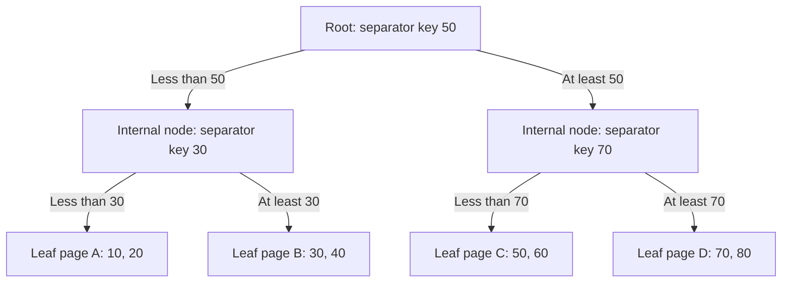
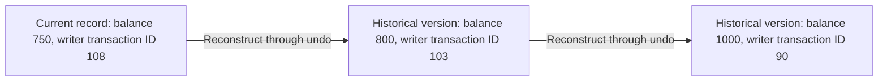
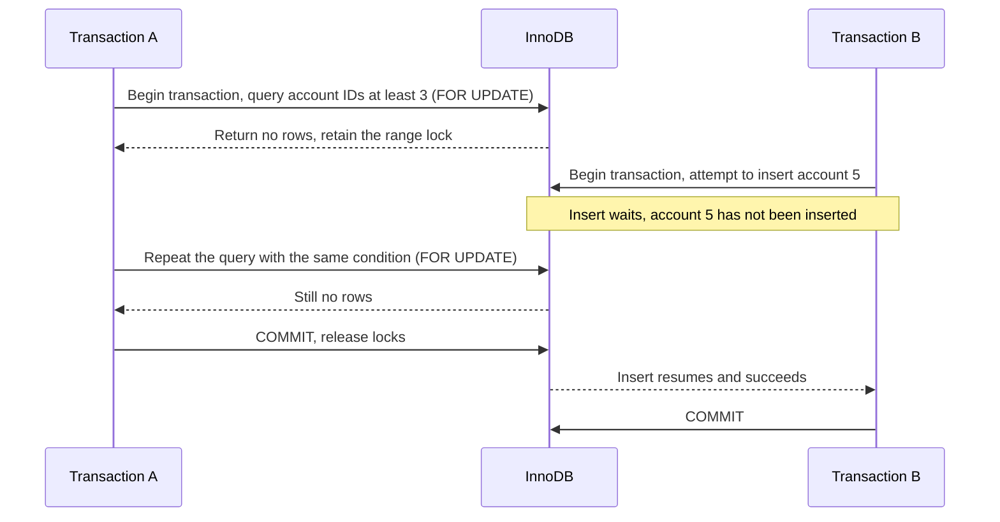
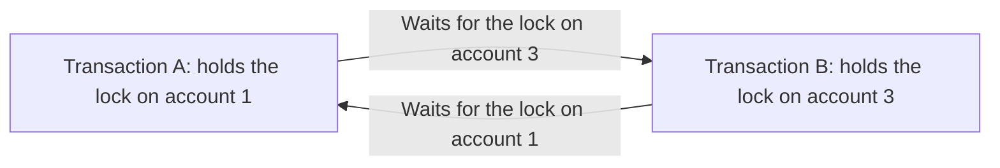

<aside class="translation-notice" role="note">This English version was machine-translated from the Chinese original. Technical terms may require verification.</aside>

## Indexes

In [Database Fundamentals](/en/blog/2024/12/23/database-systems-concepts/), we first considered what each row represents and how tables relate to one another; [SQL Fundamentals](/en/blog/2024/07/29/sql-learning-notes/) gave us a way to express queries. As data grows, the same SQL statement may need to examine many records and take a long time to return just a few results. Indexes provide a more suitable access path for these queries. This chapter uses MySQL to explain how indexes are designed and how they work.

### Index basics

#### What problem does an index solve?

Suppose we need to find order `1001` among many orders, or all orders belonging to customer `42`. The database must first identify the matching records, then read the requested fields. Without a suitable lookup structure, it may need to examine the entire table row by row.

**An index is a data structure that helps a database find records.** It organizes the values of searchable columns according to a set of rules, allowing the database to locate a particular value or a range of values. The indexed column or combination of columns is called the **index key**. For example, an index on `customer_id` organizes and searches its records using customer ID values.

MySQL's storage engine handles the storage, reading, and maintenance of data and indexes. We will use InnoDB, first explaining the structure and search process of a B+ tree, then looking at how different index types store and retrieve data.

#### How a B+ tree organizes index records

The ordinary InnoDB indexes discussed here use B+ trees. A B+ tree is a **balanced search tree with multiple children per node**. Multiple children allow each node to point to several other nodes. Balanced means that all leaf nodes are at the same level, so a search does not need to traverse many extra levels because one side of the tree is unusually deep.

First, identify three kinds of nodes:

- The **root node** is the starting point for searching the tree.
- **Internal nodes** store navigation information: keys that identify search ranges and the locations of the corresponding child nodes. A root that is not a leaf is also an internal node.
- **Leaf nodes** are at the bottom of the tree and store index records. We will explain which fields these records contain when we discuss different index types.

In InnoDB, nodes correspond to data pages, and the default index page size is 16KB. A page can hold many records or navigation entries, so visiting a node does not mean examining just one key. [The physical structure of InnoDB indexes](https://dev.mysql.com/doc/refman/8.4/en/innodb-physical-structure.html)

The following B+ tree shows just a few keys to illustrate the search process. Internal nodes use separator values to indicate the search ranges of child pages; the leaf pages currently show only index keys:



The diagram omits the links between leaf pages. They connect in key order as `A ↔ B ↔ C ↔ D`, and the records within each leaf page are also ordered by key. Internal nodes locate the page; links at the leaf level let us continue reading neighboring index records.

#### Equality and range searches in a B+ tree

First, search for the specific key `60`. Starting at the root, `60` is at least the separator value `50`, so we enter the internal node on the right. Next, `60` is less than the separator value `70`, so we enter leaf page C. Finally, we find the index record for key `60` within that page.

The path is:

```text
Find 60: root → right internal node → leaf page C → matching index record
```

During the search, keys in internal nodes provide navigation. We still need to reach a leaf node to obtain the record. Even if the target key also appears in an internal node, its role there is to divide search ranges.

Now search the range `30 ≤ key ≤ 60`. Locate the starting key `30` in the same way, reaching leaf page B. After reading `30, 40` from that page, follow the leaf link to C and read `50, 60`. Stop at the end of the range. These records lie in neighboring leaf pages, allowing the scan to continue along the leaf level.

There are two levels of positioning here: the B+ tree locates a page, and the structure within that page locates a record. InnoDB's page directory stores the positions of record groups, so the search can first locate a group and then search within it. Each key within a page does not require a separate disk read. [Understanding searches within a data page](https://www.xiaolincoding.com/mysql/index/page.html)

#### Why use a B+ tree, and what does reading it cost?

We want an index to locate a single value quickly and retrieve a range efficiently. The paths above help explain the advantages of B+ trees:

| Structural feature | Effect on searching |
| --- | --- |
| An internal node contains several keys and child page locations. | More branches usually allow the same amount of data to fit into fewer levels. |
| Internal nodes mainly store navigation information, with records concentrated at the leaf level. | An internal page of a given size can hold more navigation entries. |
| Leaf pages are linked in key order. | After locating the start of a range, the database can continue scanning neighboring index records. |

Internal nodes still store navigation keys and child node locations; they do not store the complete rows used to return query results. Inserts and deletes also incur maintenance costs. An insert may split a page, while a delete may lead to merging pages with low utilization. These adjustments can sometimes propagate to parent nodes. Maintenance cost depends on the writes and the state of the pages. Redundant navigation keys alone do not establish that inserts and deletes are always cheaper.

A binary search tree has at most two children per node and usually needs more levels as data grows. A conventional B-tree can also store data entries in internal nodes. A B+ tree keeps result records at the leaf level, allowing internal nodes to concentrate on navigation. Hash structures use hash functions to organize lookups. They are mainly suited to equality searches and lack an ordering by key, so they cannot directly provide the same range scans and sorting capabilities. [Search and Sorting Algorithms](/en/blog/2024/12/18/search-and-sorting-algorithms/) provides related background.

We must distinguish the number of nodes visited from the number of disk reads. InnoDB uses the **Buffer Pool** to cache data and index pages. A page already in this memory area can be accessed directly; otherwise, the relevant page must be read. A shorter tree can reduce the number of pages visited while locating a record, but this does not guarantee a faster query. The cost also depends on how many index records are scanned after positioning. We will follow this path further when discussing secondary indexes and clustered index lookups.

We now know how an index searches by key, scans a range, and may need structural adjustments after inserts or deletes. Next, connecting the B+ tree to table data will help distinguish clustered and secondary indexes, and then clustered index lookups and covering indexes.

#### What the different index classifications describe

B+ trees explain how index keys are organized and searched. We also need to distinguish what an index stores, which constraints it enforces, and how many columns it includes. One index can belong to several classifications:

| Classification | Common terms | Meaning |
| --- | --- | --- |
| Data structure | B+ tree, hash | B+ trees organize keys in an ordered tree; hash structures use hash functions for equality lookups. |
| InnoDB data organization | Clustered index, secondary index | Clustered index leaf records hold entire rows. Secondary index leaf records hold indexed column values and the primary key, providing a lookup path through other fields. |
| Constraints | Primary key index, unique index, nonunique index | A primary key must be unique and nonnull. A unique index restricts duplicate key values. A nonunique index permits duplicates. |
| Number of key columns | Single-column index, composite index | A single-column index uses one column as its key; a composite index uses a combination of columns. |
| Indexed contents | Complete column values, string prefixes, expression results | An index can store complete column values, the beginning of a string, or the result of an expression. |

For example, a nonunique index on `customer_id` can simultaneously be a B+ tree index, a secondary index, a nonunique index, and a single-column index.

#### How a clustered index stores complete rows

**InnoDB organizes complete rows by index key in the leaf nodes of a B+ tree. An index that directly organizes data rows in this way is called a clustered index.** Internal nodes provide navigation, while leaf nodes contain the records themselves. Reaching a leaf record through this tree therefore provides the row's data.

If a table declares a primary key, InnoDB uses it as the clustered index key. The primary key defines the unique identity of a row; the clustered index describes how rows are organized in storage. In InnoDB, the two are connected in this way.

Create a separate orders table for the examples:

```sql
CREATE TABLE orders_index_demo (
    order_id BIGINT NOT NULL PRIMARY KEY,
    customer_id BIGINT NOT NULL,
    status VARCHAR(16) NOT NULL,
    ordered_at DATETIME NOT NULL,
    total_amount DECIMAL(12, 2) NOT NULL,
    INDEX idx_customer (customer_id)
) ENGINE=InnoDB;
```

`PRIMARY KEY` declares the order ID as the primary key, while `INDEX idx_customer (customer_id)` declares an index for searching by customer ID. The following examples explain the contents of these indexes and the resulting query paths.

Suppose the table contains four orders. The user fields in the clustered index leaf records can be represented as:

| order_id | customer_id | status | ordered_at | total_amount |
| --- | --- | --- | --- | --- |
| 1001 | 42 | paid | 2026-10-01 09:00:00 | 100.00 |
| 1002 | 43 | paid | 2026-10-01 08:00:00 | 120.00 |
| 1003 | 42 | pending | 2026-10-01 11:00:00 | 80.00 |
| 1004 | 42 | paid | 2026-10-02 10:00:00 | 90.00 |

Records are organized by `order_id`. When querying by order ID, the database can follow this key through the tree to the corresponding leaf record. The following query starts with primary key `1001`. Once the leaf record is found, the customer, status, time, and amount are all available in that record:

```sql
SELECT * FROM orders_index_demo WHERE order_id = 1001;
```

Each InnoDB table has one clustered index because complete rows are organized in this one key order. InnoDB uses an explicit primary key when one exists. Without one, it chooses the first unique index whose key columns are all nonnull. If no suitable index exists, it generates a hidden row ID to organize the records. [Rules for selecting a clustered index](https://dev.mysql.com/doc/refman/8.4/en/innodb-index-types.html)

#### How secondary indexes support queries on other fields

The clustered index organizes data by order ID, but we also frequently look up orders by customer ID. One customer's order IDs may be spread across different positions, so we need another access path organized by customer ID.

**A secondary index is an index created in addition to the clustered index.** For `idx_customer`, the index key is `customer_id`, and leaf records contain the customer ID and the corresponding primary key, `order_id`. The four orders above can be represented in this index as:

| customer_id | order_id |
| --- | --- |
| 42 | 1001 |
| 42 | 1003 |
| 42 | 1004 |
| 43 | 1002 |

To find customer `42`'s orders, the database can first locate this customer's range in the secondary index, then obtain the order IDs within that range. The secondary index provides a different search order for the same data.

Compare the two trees: the clustered index navigates by order ID and stores complete rows in its leaves. The customer secondary index navigates by customer ID and stores customer IDs and primary keys in its leaves. Those primary key values allow further lookups of the rows in the clustered index.

#### Clustered index lookups and covering indexes

Suppose the query needs the complete order data for customer `42`:

```sql
SELECT * FROM orders_index_demo WHERE customer_id = 42;
```

When using `idx_customer`, the database first obtains order IDs `1001`, `1003`, and `1004`. The amount, status, and time are absent from this secondary index, so it must use each order ID to find the complete row in the clustered index. **Obtaining a primary key from a secondary index and then visiting the clustered index for the required data is called a clustered index lookup.**

```text
customer_id = 42
    → customer secondary index
    → corresponding order_id
    → clustered index lookup by order_id
    → complete row
```

The situation changes if the query only needs order IDs:

```sql
SELECT order_id FROM orders_index_demo WHERE customer_id = 42;
```

`customer_id` provides the filter and `order_id` the result. Both columns are present in the customer secondary index. **When an index provides the columns needed by a query, the query can use a covering index, reducing the need to read complete rows.** The same `idx_customer` covers a query that returns only order IDs, but does not cover one that needs amounts.

This makes the distinction between two costs clearer: how many index records are found, and whether obtaining them requires further clustered index lookups. Index optimization will use this distinction.

#### How a composite index orders multiple fields

The customer index above uses one column. When a query considers customer, status, and time together, it can use a combination of columns as the index key. This is a **composite index**.

A composite index on `(customer_id, status, ordered_at)` sorts first by customer, then by status within each customer, and then by time within each customer and status. The orders above can be represented in this key order as:

```text
(42, paid,    2026-10-01 09:00:00)
(42, paid,    2026-10-02 10:00:00)
(42, pending, 2026-10-01 11:00:00)
(43, paid,    2026-10-01 08:00:00)
```

Specifying a customer ID locates a continuous range for that customer. Specifying a status further narrows it. Once these two values are fixed, records within that range are ordered by time.

The **leftmost prefix rule** follows from this ordering. Conditions starting with the leftmost column allow the database to progressively locate a range in the usual way. With only `status` specified, the same status is spread across different customers' ranges, so the same prefix positioning generally cannot be used directly.

### When an index is needed

#### Start with how common queries access the data

Indexes should be designed around queries and constraints. Seeing a column in `WHERE` is not enough to decide that it needs its own index. A more useful question is whether a candidate index can reduce the records examined, avoid additional sorting, or reduce reads of complete rows.

| Use case | Index to consider | What else to examine |
| --- | --- | --- |
| Lookup by order ID or business identifier | Primary key or unique index | Is uniqueness actually required, and is this key queried frequently? |
| Find a customer's orders | Index beginning with customer ID | How many orders does each customer usually have, and what other filters are used? |
| Find recent orders by customer and status | Composite index matching filters and ordering | Can it narrow the range and read in the required time order? |
| Table joins | Index on the join field of the lookup side | Are join order and field types suitable, and how many rows match each lookup? |
| Grouping, sorting, minimum, or maximum queries | Index matching the actual access order | Does the query meet the conditions for index optimization, and is extra processing still needed? |
| Frequent queries returning few fields | Index covering those fields | Does reducing complete-row reads justify the cost of another index? |

For example, 'a customer's most recent paid orders' involves customer, status, time ordering, and a result limit. Separate indexes on these fields generally do not provide the combined order maintained by a composite index. Evaluate candidate indexes against the complete SQL statement.

A unique index has another purpose: preventing duplicate writes that violate business rules. Even if a unique key is rarely queried, it remains useful when the database must enforce that constraint. Evaluate this separately from nonunique indexes created solely to accelerate queries.

#### Understand distinctness in the context of data distribution

A column's distinctness is commonly described by the ratio of distinct values to total records. Customer IDs often have more distinct values than order statuses. What matters for the cost of a particular query, however, is how many records its condition is expected to match.

Suppose most orders are completed, only a small fraction are pending, and the administration interface frequently queries pending orders. Even if `status` has only a few possible values, an index may still help that query. Conversely, a time column with many distinct values may be unsuitable for repeated secondary-to-clustered index lookups if a query covers almost all historical records. Neither 'never index columns with few distinct values' nor 'stop using an index above a fixed matching percentage' is a general rule. Returned fields, ordering, `LIMIT`, cache state, and the optimizer's cost estimates also matter.

#### Weigh read benefits against maintenance costs

Indexes occupy disk space and cache capacity. Inserts and deletes require maintaining the relevant indexes. Updating an indexed column may also change the position of its index record.

Adding a nonunique index may provide little benefit for small tables, reports processing most records, rarely used filters, or queries already served by existing indexes. Frequently changing fields also require comparing read and write costs. An order status changes over time, but administration queries may depend heavily on it, making an index worthwhile. Decide how many indexes to retain from the actual workload.

### How to optimize indexes

#### Organize a composite index around the query

Consider this order list query:

```sql
SELECT order_id, ordered_at, total_amount
FROM orders_index_demo
WHERE customer_id = 42
  AND status = 'paid'
  AND ordered_at >= '2026-10-01 00:00:00'
ORDER BY ordered_at DESC
LIMIT 20;
```

We can evaluate the following candidate index:

```sql
CREATE INDEX idx_customer_status_time
ON orders_index_demo (customer_id, status, ordered_at);
```

Customer and status are equality conditions that identify a range. Within it, time is ordered, allowing the database to restrict the time range and read from newer records toward older ones. Compared with locating by customer alone, then filtering status and sorting, this index provides a path better suited to the query. Placing equality conditions first, followed by range or sorting fields, is a starting point for this kind of query. Other SQL statements also affect the choice of column order.

#### Distinguish reducing scans from reducing clustered index lookups

The list above also needs `total_amount`, which is absent from the candidate secondary index, so matching records still need clustered index lookups. If the list returns only order IDs and times, the query can become:

```sql
SELECT order_id, ordered_at
FROM orders_index_demo
WHERE customer_id = 42
  AND status = 'paid'
  AND ordered_at >= '2026-10-01 00:00:00'
ORDER BY ordered_at DESC
LIMIT 20;
```

The candidate composite index covers this query. Customer, status, and time can provide the filters, while time and the primary key provide the results. All required fields are available in the index. Since a secondary index already stores the primary key, returning `order_id` alone does not require adding it again to the index definition. Covering reduces the need to read complete records, although InnoDB may still visit the clustered index for some transaction visibility checks.

Another optimization is **Index Condition Pushdown (ICP)**. Suppose the candidate index instead uses `(customer_id, ordered_at, status)`. The following discussion concerns the query path with this column order:

```sql
SELECT order_id, total_amount
FROM orders_index_demo
WHERE customer_id = 42
  AND ordered_at > '2026-10-01 00:00:00'
  AND status = 'paid';
```

In this key order, the customer equality condition and time range can locate the scan interval. The following status column generally cannot narrow that time interval into a smaller continuous interval. Status is still present in index records, however. When the query is eligible for ICP, the storage engine can check status first and read complete rows only for records that pass, reducing clustered index lookups. Covering indexes address whether the required columns can come directly from the index. ICP addresses whether some records can be rejected within the index before reading complete rows. Both may reduce reading costs without necessarily reducing the number of index records traversed.

#### Use EXPLAIN to check the actual access path

The indexes above are candidates. To see which path the optimizer chooses, examine the **execution plan**: which index the database plans to use, how many records it expects to examine, and whether additional sorting is needed. Add `EXPLAIN` before the order query; here we request the traditional table format:

```sql
EXPLAIN FORMAT=TRADITIONAL
SELECT order_id, ordered_at, total_amount
FROM orders_index_demo
WHERE customer_id = 42
  AND status = 'paid'
  AND ordered_at >= '2026-10-01 00:00:00'
ORDER BY ordered_at DESC
LIMIT 20;
```

Start with three fields:

| Field | What to examine |
| --- | --- |
| `key` | Which index the optimizer selected, and whether it matches the candidate. |
| `rows` | The estimated number of records to examine, and whether the range is still large. |
| `Extra` | Other processing, such as index covering, index condition pushdown, or additional sorting. |

In `Extra`, `Using index` means that the index covers the required columns, `Using index condition` indicates ICP, and `Using filesort` indicates additional sorting. They correspond to the different costs discussed above.

`rows` is an estimate, not a measurement of actual rows scanned or query time. The optimizer may choose a table scan when the practice table is very small. Evaluate index effectiveness with data close to the actual scale and distribution. [EXPLAIN output fields](https://dev.mysql.com/doc/refman/8.4/en/explain-output.html)

### Designing pagination

Pagination must consider both how readers use the list and how the database accesses it. Returning only 20 records per page does not mean the database processes only 20 records. Whether users can jump to any page and whether the interface displays an exact total also affect the backend query design.

#### Define ordering and the API contract first

Continue using the practice orders table, with orders listed from newest to oldest. With only `ORDER BY ordered_at DESC`, orders sharing a timestamp have no defined order, and a different execution plan may change their relative positions. Add the unique order ID: `ORDER BY ordered_at DESC, order_id DESC`. Each order then has a definite position. The earlier `(customer_id, status, ordered_at)` index remains a candidate. In InnoDB, secondary indexes also carry primary key `order_id`, and the optimizer can use this index extension for searching and sorting. Once customer and status are fixed, it can read in time and order ID order.

The API must also define the pagination contract. An administration list that allows users to enter a page number can accept a page number and page size. A feed browsed continuously can use a cursor left by the previous page. The server should limit page size and agree with the frontend on returned fields and whether totals are provided. If the interface only needs to know whether another page exists, it usually does not need an exact total for every request.

#### Why OFFSET pagination becomes more expensive

Traditional page-number pagination uses `LIMIT offset, page_size`. With page numbers starting at 1, `offset = (page_no - 1) × page_size`. Suppose customer `42` has enough paid orders. This query returns 20 records after skipping 50000:

```sql
SELECT order_id, ordered_at, total_amount
FROM orders_index_demo
WHERE customer_id = 42
  AND status = 'paid'
ORDER BY ordered_at DESC, order_id DESC
LIMIT 50000, 20;
```

**OFFSET is the number of matching results to skip, not an index key that can be located directly.** A B+ tree can find a starting point by key, but cannot directly turn 'the 50001st matching result' into a key. With a common ordered scan, this query passes through about 50020 matching records and discards the first 50000. These skipped records account for much of the difference: more index entries are traversed and more pages visited. When returned fields are absent from the secondary index, complete rows may also be read for records that will never be returned. Even when pages are cached, scanning and processing consume CPU time.

#### Defer complete-row reads with a covering index

When arbitrary page jumps are required, first obtain the primary keys for the requested page through the index, then read the displayed fields. This is commonly called a **deferred join** and can be understood as postponing clustered index lookups:

```sql
SELECT o.order_id, o.ordered_at, o.total_amount
FROM orders_index_demo AS o
JOIN (
    SELECT order_id, ordered_at
    FROM orders_index_demo
    WHERE customer_id = 42
      AND status = 'paid'
    ORDER BY ordered_at DESC, order_id DESC
    LIMIT 50000, 20
) AS page_ids ON page_ids.order_id = o.order_id
ORDER BY o.ordered_at DESC, o.order_id DESC;
```

The inner query needs customer, status, time, and primary key, all available from the candidate index, so it can first scan narrower index records. The outer query uses this page's primary keys to retrieve amounts and other fields. The inner `LIMIT` prevents it from being merged directly into the outer query block. The outer query must also declare its ordering explicitly.

This mainly reduces the cost of reading complete rows. The inner query still passes the first 50000 matching results, so a large offset retains its scanning cost. If the original query is already covered by an index or the offset is small, an extra join may not be worthwhile.

#### Continue from the previous page with a cursor

Continuous browsing can use **keyset pagination**. Save the sorting keys of the last record on the previous page, then start the next page after that key. Here, the cursor is a pagination position stored by the application.

Suppose the last order on the previous page has timestamp `2026-10-02 10:00:00` and order ID `1004`. With both time and order ID descending, the next page needs earlier orders, or orders with the same timestamp and smaller IDs:

```sql
SELECT order_id, ordered_at, total_amount
FROM orders_index_demo
WHERE customer_id = 42
  AND status = 'paid'
  AND (
      ordered_at < '2026-10-02 10:00:00'
      OR (ordered_at = '2026-10-02 10:00:00' AND order_id < 1004)
  )
ORDER BY ordered_at DESC, order_id DESC
LIMIT 21;
```

Time and ID together define the pagination boundary. Saving only time would miss orders at that timestamp that have not yet been returned. Using only `order_id < 1004` cannot express a list ordered primarily by time. Strict less-than conditions exclude the last record already returned on the previous page. Check this composite boundary together with the index order to confirm that the optimizer produces an appropriate range access.

For pages of 20 records, fetch one extra: if 21 are found, return the first 20 and set `has_more = true`; fewer than 21 means there are no further records. When another page exists, `next_cursor` must use the time and ID of **the last record actually returned, the 20th record**, rather than the 21st record used only to check for another page. Otherwise, that record would be skipped. Omit the cursor boundary on the first page. Subsequent requests carry the cursor and the same filters; changing filters or ordering should restart pagination. With a suitable index and execution plan, the cursor lets the database continue scanning near the boundary without repeatedly traversing all earlier pages.

If each page is queried in a separate transaction, a cursor does not automatically hold the entire list within one snapshot. For example, the previous page has already returned order `1004`, and the cursor stores its timestamp, `2026-10-02 10:00:00`. If that order's timestamp is later changed to `09:00:00` on the same day, the next page still uses the old cursor, and the order may fall within its range again, producing a duplicate. An order not yet returned may also be missed if it moves to a position before the cursor.

Sorting fields should therefore remain as stable as possible. The API must also define whether the list follows live changes or reads a fixed set of results. A cursor reduces the cost of skipping records from the beginning; it does not automatically provide a consistent snapshot across requests.

| Pagination method | Main reading cost | Suitable requirements |
| --- | --- | --- |
| OFFSET pagination | Larger offsets usually require passing more records. | Shallow pages and arbitrary page-number jumps. |
| Deferred join | Still scans the index records covered by the offset; mainly reduces early complete-row reads. | Page jumps where complete-row reads are costly. |
| Keyset pagination | Uses sorting keys to locate a boundary and then read the page; additional filtering may still increase scanning. | Continuous browsing and batch traversal. |

## Transactions

Indexes help the database find records. Transactions address another set of questions: how several changes complete together, and which data each transaction can see when several transactions read and write concurrently. Using InnoDB, we will begin with a transfer, then work through isolation levels, historical versions, and phantom reads.

### Understanding transactions and ACID through a transfer

#### Why group two changes together?

Suppose `accounts_tx_demo` is an accounts table, with `account_id` as its primary key and `balance` storing the balance. Account 1 has 1000 yuan and account 2 has 500 yuan. We want to transfer 100 yuan from account 1 to account 2.

The database must subtract 100 from account 1 and add 100 to account 2. If the changes commit separately and the program stops after the first step, the money may be debited without being credited. We want the changes to form one unit: commit after confirming that both succeeded, or undo the uncommitted changes if we abandon the operation.

**A transaction is a unit of work that commits or rolls back together.** When both accounts exist, the balance is sufficient, and both updates succeed, the basic transfer can be written as:

```sql
START TRANSACTION;

UPDATE accounts_tx_demo
SET balance = balance - 100.00
WHERE account_id = 1;

UPDATE accounts_tx_demo
SET balance = balance + 100.00
WHERE account_id = 2;

COMMIT;
```

`START TRANSACTION` begins the transaction, and `COMMIT` commits its changes. The resulting balances are 900 and 600. To abandon the operation before committing, use `ROLLBACK` to undo its uncommitted changes. The concurrency examples below are independent; each balance example starts again at 1000.

#### What ACID describes

The four transaction properties are abbreviated as **ACID**. Continue using the transfer to understand them:

| Property | Meaning | Transfer requirement |
| --- | --- | --- |
| Atomicity | Changes within a transaction commit or roll back as a unit. | The debit and credit complete together, or both are undone. |
| Consistency | Data constraints and business rules hold before and after the operation. | Without fees, the total remains 1500, and the two changes have equal amounts. |
| Isolation | Defines visibility and interactions between concurrent transactions. | Other requests reading or changing balances follow defined reading and conflict rules. |
| Durability | Successfully committed results survive recovery from a failure. | Confirmed transfer results remain after a database restart. |

Consistency requires correct business logic. Putting 'subtract 100, add 80' in a transaction and committing it still produces an incorrect transfer. A transaction cannot decide whether the amounts are appropriate. Isolation addresses interactions when transactions interleave reads and writes. Durability means preserving committed results after recovery. An implementation can first reliably persist the necessary logs, allowing recovery even if the relevant data pages have not all been written back to data files. The next section explains that relationship.

### How undo and redo logs support transactions

#### Undo log: reversing changes and reconstructing old versions

The **undo log** stores the information needed to reverse changes. For example, changing a balance from 1000 to 800 requires retaining enough information to restore the old value. InnoDB can use it to undo changes when a transaction rolls back.

It also supports isolation: another transaction may need the balance from before the change, and InnoDB can reconstruct that historical version from undo information. Undo therefore supports both rollback and the versioned reads introduced later.

#### Redo log: recording changes for recovery

As discussed earlier, data pages are cached in the Buffer Pool. Changes first occur in memory, while data files may not yet contain the latest contents. A power failure could lose changes kept only in memory.

The **redo log** records changes to data pages. Once the necessary logs are reliably persisted, the database can replay those changes after a restart to recover contents not yet fully written to data files. Data pages can then be written back gradually; committing does not require flushing every affected page immediately. **Persisting the log before writing back the data pages** is called **Write-Ahead Logging (WAL)**.

The two logs have different roles: undo supports reversal and historical versions; redo supports recovery of data changes.

### Concurrent reading problems and four isolation levels

#### Dirty reads, non-repeatable reads, and phantom reads

One transaction may read data while another changes it. Distinguish three phenomena:

| Phenomenon | Question | Example |
| --- | --- | --- |
| Dirty read | Did the query read another transaction's uncommitted changes? | B changes the balance to 800 without committing; A reads 800, and B later rolls back. |
| Non-repeatable read | Does rereading the same record within a transaction return a different value because another transaction committed? | A reads 1000; B changes it to 800 and commits; A reads 800. |
| Phantom read | Does repeating a query with the same condition within a transaction change the set of matching records? | A finds no records for `account_id >= 3`; B inserts account 5 and commits; A's next query returns account 5. |

A dirty read concerns whether a change was committed. A non-repeatable read concerns the value of the same record. A phantom read concerns which records match a condition. Phantoms often appear as a change in row count, but the underlying issue is a change in the matching set.

#### What the four isolation levels restrict

InnoDB supports four isolation levels and defaults to **REPEATABLE READ**. For now, understand a **snapshot** as the visible data state used for reading. We will later explain how it selects historical versions.

| Isolation level | Main reading rules |
| --- | --- |
| READ UNCOMMITTED | Ordinary queries may read other transactions' uncommitted changes, permitting dirty reads. |
| READ COMMITTED, or RC | Each ordinary query uses a new snapshot of committed versions; later queries may return different values or matching sets. |
| REPEATABLE READ, or RR | Ordinary queries within a transaction reuse the snapshot established by the first such query. Later commits by others do not refresh it; a transaction's own writes have separate visibility rules. |
| SERIALIZABLE | Applies stronger concurrency constraints so that results correspond to some sequential order. Ordinary reads within explicit transactions also acquire locks, and conflicting operations may wait. |

In the SQL standard's classification of anomalies, RC prevents dirty reads, RR also prevents non-repeatable reads, and SERIALIZABLE additionally restricts phantom reads. Standard RR permits phantoms, but InnoDB RR handles ordinary and locking queries differently. The final section examines this distinction.

Stronger isolation generally requires more concurrency constraints. SERIALIZABLE does not mean that the entire database permits only one transaction to run. Next, we will see how RC and RR use multiple versions to let ordinary queries read appropriate contents while other transactions modify records.

### How MVCC selects data through version chains and Read Views

#### What a version chain contains

**Multi-Version Concurrency Control (MVCC)** handles concurrent reading through different record versions and visibility rules. Under RC and RR, ordinary queries can read the required historical contents without waiting merely because another transaction is updating a record.

Clustered index leaf records contain complete rows, including two pieces of hidden transaction information:

- **`DB_TRX_ID`** identifies the transaction that last inserted or modified the record.
- **`DB_ROLL_PTR`** is a rollback pointer to an undo record, used to reconstruct the version before the change.

For example, different transactions successively change a balance from 1000 to 800, then to 750. The current record and reconstructed historical versions can be represented by this logical chain:



The diagram shows the relationship between versions. Undo does not necessarily store a complete copy of each row; it stores the information needed to reconstruct old contents.

#### How a Read View determines visibility

A **Read View** records transaction state when the view is created, allowing it to determine which written versions are visible to a read. It does not copy the entire table.

We will use four names for its transaction information and visibility boundaries:

| Information | Meaning |
| --- | --- |
| `creator_trx_id` | The ID of the transaction owning the view, used to recognize its own changes. |
| `m_ids` | IDs of other read-write transactions still active and uncommitted when the view is created. |
| `min_trx_id` | The smallest ID in the active set; if the set is empty, it can equal the upper boundary below. |
| `max_trx_id` | The next transaction ID to be allocated when the view is created, rather than the largest ID in the active set. |

Check the writer transaction ID of a version using these rules:

1. **Changes by the current transaction** are visible to itself.
2. **An ID below `min_trx_id`** represents changes committed before the view was created and is visible.
3. **An ID greater than or equal to `max_trx_id`** was allocated after the view was created and is invisible to it.
4. **An ID between the boundaries** is invisible if it is in `m_ids`, meaning it was uncommitted at view creation. If it is absent, it was already committed and is visible.

#### Walk through a concrete version chain

Suppose the transaction owning the view has acquired ID `100`. Other active writer transactions have IDs `103` and `106`, and the next ID to allocate is `108`:

```text
creator_trx_id = 100
m_ids          = [103, 106]
min_trx_id     = 103
max_trx_id     = 108
```

Reading the earlier balance version chain gives:

| Writer transaction ID | Balance | Visibility decision |
| --- | --- | --- |
| 108 | 750 | Reaches the view's upper boundary; invisible. |
| 103 | 800 | Belongs to the active set at view creation; invisible. |
| 90 | 1000 | Below the lower boundary; visible. |

This view therefore reads 1000. Even if transaction `103` commits later, it remains a transaction that was uncommitted when this Read View was created. The view does not change automatically when another transaction commits.

Not every version between the boundaries is invisible. For example, ID `104` is absent from this active set, so a version written by that transaction is visible. The decision uses **transaction state at view creation**, rather than ID order alone.

### Why RC and RR can return different results

#### The difference is when Read Views are created

Both RC and RR can follow version chains to read historical data. An **ordinary consistent read** here means an ordinary `SELECT` that reads according to a visibility snapshot; this is also called a **snapshot read**. The main difference is whether a Read View is reused:

- **RC** creates a new Read View for each ordinary consistent query.
- **RR** reuses the Read View established by the first ordinary consistent query **within the same transaction**.

`START TRANSACTION` begins the SQL transaction, but an RR Read View is normally established at the first ordinary consistent query. If another transaction commits before that query, the first query can see its result.

#### Compare reads before and after a commit

Reset account 1's balance to 1000. A and B represent two transactions. Run A once under RC and once under RR, using ordinary `SELECT` queries:

| Step | Transaction A | Transaction B |
| --- | --- | --- |
| 1 | Begins a transaction and reads the balance for the first time: 1000. | — |
| 2 | — | Begins a transaction and changes the balance to 800 without committing. |
| 3 | Reads again: both RC and RR return 1000. | The change remains uncommitted. |
| 4 | — | Commits. |
| 5 | Reads again: RC returns 800; RR still returns 1000. | — |
| 6 | Commits; a new transaction can read 800. | — |

At step 3, B has not committed. Neither RC nor RR can read its new version, so they find visible old contents. At step 5, RC creates a new view in which B has committed, making 800 visible. RR reuses the old view, still treating B's changes as uncommitted at view creation, so it continues to read 1000.

This connects isolation levels to their implementation: **the version chain supplies historical contents, the Read View decides visibility, and its creation time determines whether reads continue using the same basis.**

### Snapshot reads, current reads, and the boundaries of phantom prevention

First, separate two questions: **which records A can see, and whether B can insert new records.** The first concerns record versions; the second concerns whether the relevant range has already been locked. The examples below use InnoDB REPEATABLE READ (RR), with A and B representing two transactions. Each example starts independently from its stated initial data.

#### Distinguish snapshot and current reads using one account

Account 1 initially has a balance of 1000. A begins a transaction, reads 1000 with its first ordinary query, and establishes a Read View. B then changes the balance to 800 and commits. A's transaction remains open.

A has two query options. An ordinary `SELECT` chooses a version using the existing Read View and is a **snapshot read**. Adding `FOR UPDATE` reads the currently available record and acquires the corresponding lock; this is a **current read**. Continue executing within A:

```sql
-- Snapshot read
SELECT balance
FROM accounts_tx_demo
WHERE account_id = 1;

-- Current read
SELECT balance
FROM accounts_tx_demo
WHERE account_id = 1
FOR UPDATE;
```

| A's query | Balance read | Reason |
| --- | --- | --- |
| Ordinary `SELECT` | 1000 | The old Read View excludes B's later commit, so the query reads the old value through the version chain. |
| `SELECT ... FOR UPDATE` | 800 | Reads B's committed record under current-read rules and locks it. |
| Another ordinary `SELECT`, before A modifies the row | 1000 | A locking read does not refresh the original Read View. |

The two queries use different reading rules. A snapshot read selects a version visible to its view. A current read obtains an available current record and protects subsequent operations depending on it. If another transaction is still changing the record, a current read may first have to wait for that transaction to finish.

#### Snapshot reads hide new rows without blocking their insertion

A balance change alters the value of one record. **A phantom read concerns new matching records appearing in the result**: a transaction repeats a query with the same condition, another transaction inserts and commits a matching row, and the later query reads it. Start a new example with only accounts 1 and 2. A wants accounts whose IDs are at least 3:

```sql
SELECT account_id
FROM accounts_tx_demo
WHERE account_id >= 3;
```

Execute in this order:

| Step | Transaction A | Transaction B |
| --- | --- | --- |
| 1 | Begins a transaction, runs an ordinary query returning no rows, and establishes a Read View. | — |
| 2 | — | Inserts account 5 and commits successfully. |
| 3 | Repeats the ordinary query; the result remains empty. | — |
| 4 | Changes the query to `SELECT ... FOR UPDATE` and can see account 5. | — |

At step 3, **account 5 exists, but A's old snapshot cannot see it**. The ordinary query did not prohibit B's insertion. Keeping the same reading view prevents B's new row from changing the snapshot-read result.

Step 4 switches to a current read. Account 5 has committed and is available to that read. The reading method changed; the same reading method did not suddenly lose repeatability. Also, **a lock acquired after B's insertion cannot prevent an insertion that has already completed**.

#### Preventing concurrent inserts requires locking the range in advance

If A requires that nobody insert new accounts into the range between checking it and finishing the operation, the sequence must change.

Restore the table to accounts 1 and 2 only. A begins with a locking range query inside a transaction:

```sql
START TRANSACTION;

SELECT account_id, balance
FROM accounts_tx_demo
WHERE account_id >= 3
FOR UPDATE;

-- Keep A's transaction open, then let B attempt its insert
```

Even though the query returns no rows, the relevant insertion interval is protected. B then attempts to insert account 5:



Both of A's current reads return no rows because **B's insertion has not completed**. After A ends its transaction and releases locks, B can insert and commit. A new transaction can then see account 5.

How can a query lock anything when it finds no records? It must protect existing records and index positions where new records could be inserted. **Gap locks** restrict insertion into those positions, **record locks** protect existing index records, and **next-key locks** combine a record with the gap preceding it to protect a range.

Compare this with the previous example. Snapshot reads allow B to insert while A keeps reading the old snapshot. Acquiring range locks beforehand makes B's insertion wait. Both keep this round of reading stable through different mechanisms.

#### Why a transaction sees a row after modifying it

Start again with only accounts 1 and 2. A begins an RR transaction. Its first ordinary query for `account_id >= 3` returns no rows and establishes a Read View. B then inserts account 5 with a balance of 1000 and commits. A remains open, and the same ordinary query still cannot see account 5.

Within the same transaction, A now executes:

```sql
UPDATE accounts_tx_demo
SET balance = 900.00
WHERE account_id = 5;

SELECT account_id, balance
FROM accounts_tx_demo
WHERE account_id >= 3;
```

The update finds the account 5 that currently exists. The following ordinary query also returns account 5 with a balance of 900. A previously invisible record appears, but the two actions explain why:

1. **`UPDATE` operates on current records**, allowing it to modify account 5, which B has committed even though A's old snapshot cannot see it.
2. **A transaction's own changes are visible to itself**, so the following ordinary query can read the version A wrote.

The original Read View has not refreshed, and other transactions' later commits have not all entered the old snapshot. Only A's own changes are visible to A. When understanding InnoDB RR, distinguish three conditions: ordinary snapshot reads reuse an existing view; current reads that lock a range beforehand restrict concurrent insertion into it; and switching read methods or reading one's own changes may produce results different from an earlier snapshot read.

## Lock management

MVCC explained which versions a transaction can see, and range locks showed how an insertion can be made to wait. We now examine the locks themselves: when transactions access data concurrently, which operations can proceed together and which must wait.

The row-level locking examples in this chapter use InnoDB REPEATABLE READ (RR). A and B are transactions in different sessions, and each example is independent.

### How locks coordinate concurrent access

A has modified account 1 without committing, and B also wants to modify that record. InnoDB coordinates the changes with locks: B waits, then continues after A commits or rolls back and releases its locks.

**Locks restrict whether conflicting operations can proceed concurrently.** For the same index record, distinguish two lock modes:

| Lock held by A | B requests shared lock S | B requests exclusive lock X |
| --- | --- | --- |
| Shared lock S | Both can hold the lock. | Must wait. |
| Exclusive lock X | Must wait. | Must wait. |

Shared locks allow multiple transactions to perform locking reads of the same record. Exclusive locks protect modifications. This read/write exclusion applies to operations requiring the corresponding locks. **Ordinary snapshot reads can still read historical versions visible to their Read View.**

`SELECT ... FOR SHARE` requests shared locks, while `SELECT ... FOR UPDATE` requests exclusive locks. `UPDATE` and `DELETE` automatically acquire exclusive locks for the data they process.

For example, A uses the accounts table from earlier and keeps its transaction open after the locking query:

```sql
START TRANSACTION;

SELECT balance
FROM accounts_tx_demo
WHERE account_id = 1
FOR UPDATE;

-- Let B attempt to update account 1 in another session
-- After A finishes its work, execute COMMIT or ROLLBACK
```

B's update may stop while waiting for the lock. **In this explicit transaction, finishing the query does not release the locks.** Locks acquired by the locking read remain until commit or rollback.

By **scope**, locks can also be global, table-level, or row-level. S and X describe compatibility; these other terms describe scope. They are different classification dimensions.

### Global locks and four kinds of table-level locks

#### Global lock: temporarily stop writes across the instance

`FLUSH TABLES WITH READ LOCK` acquires a global read lock. `UNLOCK TABLES` releases it, as does disconnecting the holding session. It applies to the entire MySQL instance, beyond the currently selected database. Ordinary queries can continue, while data changes and table structure changes are blocked.

A logical backup of the whole database needs all tables to correspond to the same data state. Suppose a user has 1000 yuan in the accounts table, and the inventory table holds 10 items priced at 100 yuan each. A purchase transaction subtracts 100 yuan and one item together. After commit, the balance is 900 and inventory is 9.

Without a consistent snapshot or a pause in writes, a backup may proceed in this order:

| Step | Operation | Result at this step |
| --- | --- | --- |
| 1 | Back up the accounts table before the purchase. | The user's balance is 1000 yuan. |
| 2 | The purchase transaction deducts the money and inventory, then commits. | The database balance becomes 900 yuan and inventory becomes 9. |
| 3 | Back up the inventory table. | Inventory is 9. |

Restoring this backup produces a balance of 1000 yuan but only 9 items: inventory was reduced, while the corresponding debit is absent. The purchase transaction committed both changes together. The problem is that the backup read data from before and after that commit.

Holding a global read lock during the backup prevents these changes, keeping the accounts and inventory tables in the same data state. The cost is that purchases and other writes must wait for the backup to release the lock.

#### Table locks: restrict access to a whole table

`LOCK TABLES` acquires explicit table locks. Common forms are:

| Form | Holding session | Other sessions |
| --- | --- | --- |
| `LOCK TABLES accounts_tx_demo READ` | Can read this table but cannot write to it. | Can read; writes must wait. |
| `LOCK TABLES accounts_tx_demo WRITE` | Can read and write this table. | Reads and writes to this table must wait. |

The holding session also cannot freely access other tables that it did not declare as locked. `UNLOCK TABLES` explicitly releases these locks, and disconnecting the session also releases them. `LOCK TABLES` implicitly commits the current transaction before attempting to acquire locks, so it cannot be inserted into the earlier transfer transaction as if it were an ordinary row-locking statement.

Table locks may block requests unrelated to the target record. Ordinary InnoDB transaction reads and writes mainly use finer row-level locks. [Explicit table lock behavior](https://dev.mysql.com/doc/refman/8.4/en/lock-tables.html)

#### Metadata locks: protect table structure

**Metadata locks (MDL)** protect structural definitions such as columns and indexes, preventing one session from deleting a column while another query is still reading it. Accessing a table automatically acquires the relevant MDL. Ordinary data reads and writes are generally compatible; conflicting structural changes must wait.

For example, if A queries the accounts table in an explicit transaction and leaves it open, B's `ALTER TABLE` may wait. **Even after the query returns, MDL normally remains until the transaction ends.** Once a structural change is queued, later queries may also wait. Saying that an ordinary `SELECT` does not acquire row locks means it does not lock the data records; **it does not mean the database acquires no locks at all for that query.**

#### Intention locks: indicate row-locking requirements within a table

A request for a whole-table lock needs to determine whether other transactions have locked records. Checking each record would be expensive.

InnoDB automatically acquires table-level intention locks before row locks. An **intention shared lock (IS)** indicates shared row-locking requirements, and an **intention exclusive lock (IX)** indicates exclusive row-locking requirements. For example, A first acquires a table-level IX when using `FOR UPDATE` to lock account 1. B can use that information to determine conflicts when requesting a whole-table lock.

**An intention lock does not itself lock all the table's data.** A and B can both hold IX locks and modify different accounts. Whether they wait depends on conflicts between the particular row locks they request.

#### AUTO-INC locks: coordinate allocation of automatic IDs

A column declared `AUTO_INCREMENT` requires coordination when concurrent inserts allocate values. An **AUTO-INC lock** is a special table-level lock for this process. It is normally held until the current insert statement finishes, **without waiting for the entire transaction to commit**.

InnoDB also provides lighter allocation methods, controlled by `innodb_autoinc_lock_mode`:

| Mode | Basic behavior |
| --- | --- |
| 0, traditional | Inserts use a table-level AUTO-INC lock held until the statement ends. |
| 1, consecutive | Ordinary inserts with a known row count usually coordinate briefly while allocating IDs; bulk inserts such as `INSERT ... SELECT` still use a table-level AUTO-INC lock. |
| 2, interleaved | Does not use table-level AUTO-INC locks and permits interleaved allocation by multiple insert statements. |

These modes trade predictable ID allocation against insert concurrency. For example, in mode 2, automatic IDs start at 1. A uses `INSERT ... SELECT` to insert two records while B inserts one. A's first record may receive 1, B's record 2, and A's next record 3.

If a replica only replays the two SQL statements and executes all of A before B, A's records may receive 1 and 2, while B receives a later ID. This differs from the original allocation and explains why statement-based replication is unsuitable for interleaved mode. Row-based replication sends actual row contents, including the IDs already allocated, so it need not reproduce the same allocation timing.

### How row-level locks protect records and gaps

InnoDB row-level locks apply to **index records and their gaps**. Even without an explicit primary key, InnoDB selects or generates a clustered index for locking. The number of rows returned alone does not determine the lock range.

Start with independent data: accounts `1, 3, 7`, with `account_id` as the primary key.

#### Record locks: protect existing index records

A **record lock** locks one index record. For example, an X record lock on account 7 makes other transactions wait when updating, deleting, or performing a locking read of it. That record lock alone does not prohibit inserting accounts 4 or 5.

Locking only existing records cannot restrict insertion of new accounts between them.

#### Gap locks: restrict insertion between records

A **gap lock** protects a gap between index records, or a gap before the first record or after the last. For example, locking `(3, 7)` prevents other transactions from inserting accounts 4, 5, or 6.

The parentheses exclude the existing records at both ends. A gap lock restricts **inserting new records into that position**; it does not also lock accounts 3 and 7.

**Different transactions can hold gap locks on the same gap simultaneously.** They jointly restrict insertion without excluding one another.

#### Next-key locks: protect a record and its preceding gap

A **next-key lock** combines a record lock with the preceding gap lock. For example, an X next-key lock on account 7 covering `(3, 7]` protects account 7 and restricts insertion into the gap before it.

| Lock | Can another transaction update or delete account 7? | Can another transaction insert account 5? |
| --- | --- | --- |
| X record lock on account 7 | Must wait. | This lock alone does not block it. |
| Gap lock on `(3, 7)` | This lock alone does not block it. | Must wait. |
| X next-key lock on `(3, 7]` | Must wait. | Must wait. |

The record portion of a next-key lock restricts updates and deletes; the gap portion restricts inserts. MVCC still determines which records an ordinary snapshot read can see.

### How SQL and indexes determine lock ranges

#### Unique lookups and range scans need different protection

Continue with accounts `1, 3, 7`. The following are locking queries within already open transactions. Also assume a nonunique secondary index, `idx_balance(balance)`, exists. Common situations differ by lookup method and whether a matching record exists:

| Query method | Basic locking approach |
| --- | --- |
| Equality lookup on a primary key or unique index, with an existing target | A unique existing record can be located, so a record lock is normally sufficient; for example, `account_id = 3`. |
| Equality lookup on a primary key or unique index, with an absent target | Protects the gap where the target could be inserted. An empty result for `account_id = 4` still protects `(3, 7)`. |
| Equality lookup on a nonunique index | Continues scanning records with the same value and protects relevant gaps against new equal-valued records. With no matches, the corresponding insertion position still needs protection. |
| Range query on a unique or nonunique index | Protects the index records and gaps involved in the scan, usually using next-key locks; boundaries may be adjusted. |

After finding a complete unique key, a unique index establishes that no second record can have that key. A nonunique index has no such guarantee. After finding one account with balance 1000, it must scan other equal-valued records and restrict further inserts. Filtering only part of a composite unique index also may not uniquely locate a record.

Exclusive locking through a secondary index also protects the corresponding clustered index records. A secondary index is organized by indexed column values and primary key values. Two accounts with the same balance but different primary keys still have separate ordered positions; balance alone does not describe the insertion position. The central purpose is **protecting the records and insertion positions involved in the scan**.

#### Why an unsuitable index can affect the whole table

Suppose `balance` is unindexed. Under RR, A executes this update and keeps the transaction open:

```sql
START TRANSACTION;

UPDATE accounts_tx_demo
SET balance = balance - 100.00
WHERE balance = 1000.00;

-- Leave A uncommitted and observe whether other transactions' updates or inserts wait
```

Without a way to locate targets by balance, the database scans the clustered index. Even if only a few records are ultimately modified, the scan may lock many records and gaps, blocking other modifications and inserts across the table. Extensive record and gap locking can have an effect similar to making the whole table unavailable for changes. Indexes affect both query costs and lock ranges, so check whether the execution plan uses a suitable index.

### INSERT and insert intention locks

Inserting a record requires protecting the new record and checking whether the insertion position is available. An **insert intention lock** is a special gap lock used for insertion, indicating that a transaction intends to insert at a particular index position.

Without other conflicts, A can insert account 4 and B account 5. These different positions do not block each other merely because they lie in the same gap. If another transaction has locked the whole `(3, 7)` gap, both inserts must wait.

**Insert intention locks differ from table-level IS and IX locks.** The former concern particular insertion positions, while the latter coordinate table and row locking.

A successfully inserted record needs exclusive protection. Suppose A inserts account 4 without committing. Even if no explicit lock structure is immediately created for that record, InnoDB can use its transaction information to recognize that A still protects it. This is an **implicit lock**.

If B later tries to modify account 4, the database can convert this protection into an explicit lock and make B wait for A to finish. An absent lock structure in lock information therefore does not mean another transaction can freely modify the new record. Primary key and unique index duplicate checks can also make inserts wait: when an uncommitted transaction wrote a conflicting record, the insert must wait for that transaction to finish before determining whether it can proceed. [Insert locking and duplicate checks](https://dev.mysql.com/doc/refman/8.4/en/innodb-locks-set.html)

### Understanding deadlocks through lock waits

#### A deadlock is a cycle of mutual waiting

A holds the lock on account 1 and B waits for its release. This is a lock wait. If A can commit normally, B can continue.

A deadlock is different. For example, two transactions both modify accounts 1 and 3, but in opposite orders:

| Step | Transaction A | Transaction B |
| --- | --- | --- |
| 1 | Updates account 1 and holds its exclusive lock. | Updates account 3 and holds its exclusive lock. |
| 2 | Attempts to update account 3 and waits for B. | Attempts to update account 1 and waits for A. |



A and B each hold a lock the other needs, and neither can reach commit. This is a **deadlock**. Four conditions are present: mutual exclusion, hold and wait, no preemption, and circular wait.

#### Why checking for absence before inserting can also deadlock

Start again with accounts `1, 3, 7` and primary key `account_id`. A wants to add account 4 and B account 5. Both first use `FOR UPDATE` to check whether their target exists, then insert if it does not. A and B execute `START TRANSACTION` in their respective sessions, use RR, and proceed in this order:

| Step | Transaction A | Transaction B |
| --- | --- | --- |
| 1 | Runs `SELECT account_id FROM accounts_tx_demo WHERE account_id = 4 FOR UPDATE`; no rows. | — |
| 2 | Keeps the transaction open. | Runs `SELECT account_id FROM accounts_tx_demo WHERE account_id = 5 FOR UPDATE`; no rows. |
| 3 | Executes `INSERT INTO accounts_tx_demo (account_id, balance) VALUES (4, 1000.00)` and waits for B to release its gap lock. | Keeps the transaction open. |
| 4 | Still waits for B. | Attempts `INSERT INTO accounts_tx_demo (account_id, balance) VALUES (5, 1000.00)`, which also requires A to release its gap lock. |

At step 1, account 4 is absent, so A protects its possible insertion gap, `(3, 7)`. At step 2, B also protects that gap when querying account 5. **The two gap locks are compatible, so both queries return successfully.** Both transactions now hold unreleased gap locks.

At step 3, A's own gap lock does not block its own insertion, but B also locks that position, so A waits for B. At step 4, B wants to insert account 5 but must wait for A's gap lock. Neither transaction can first complete its insert and then commit to release its locks. Their wait relationship forms a cycle.

With deadlock detection enabled, InnoDB chooses one transaction to roll back so the other can continue. This example shows that **an empty query can still protect an insertion position; gap locks are compatible with each other, while an insertion request conflicts with another transaction's gap lock.**
